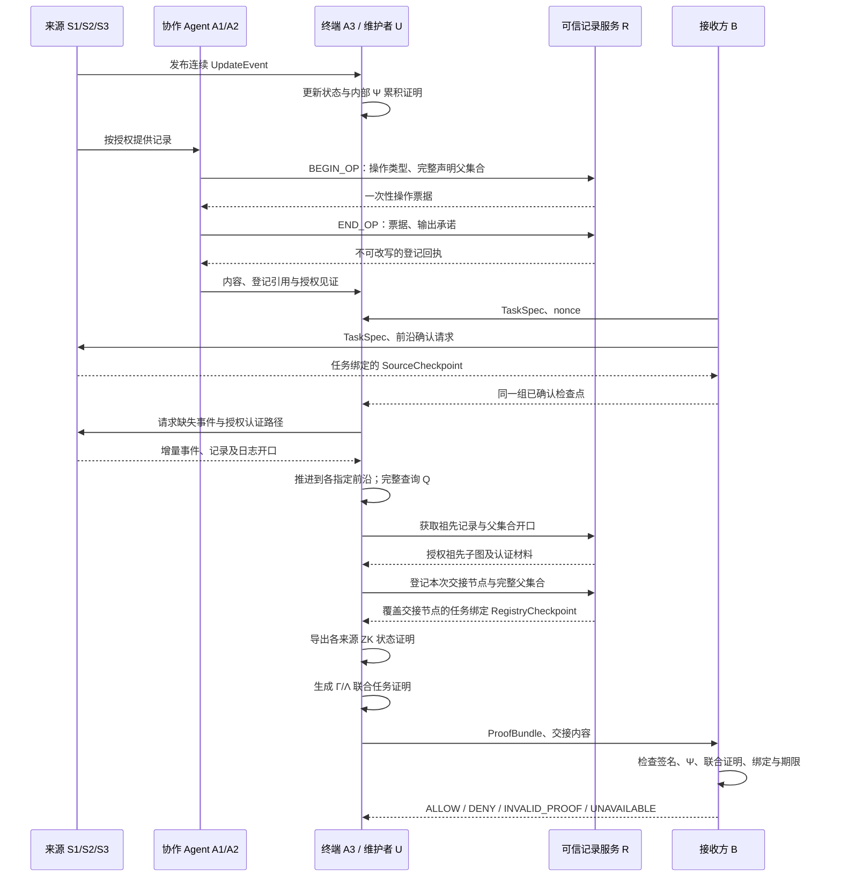
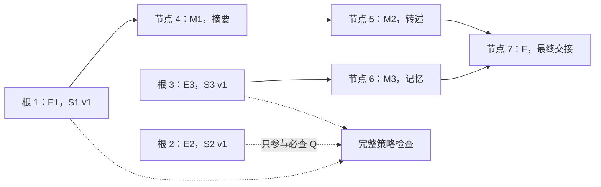

# Ψ＋Γ＋Λ：动态私有证据完整性与传承验证协议方案

> 文档性质：待实现、待验证的协议与原型设计。本文只规定“怎样做”，不包含摘要、引言，不代表已经完成安全证明或性能实验。版本：设计稿 v1 修订稿，2026-11-10；本次小修限定交接输出、区分拒绝原因、消除承诺编码歧义，并增加最小真实证明阶段。
>
> 基础路线：终端聚合见证；公开任务规则；独立可信记录服务；按认证结构完整扫描必查记录；每个来源一个状态证明，最终交接一个 Γ／Λ 联合零知识证明。

## 1. 系统模型与实施边界

### 1.1 要实现的四项性质

| 性质 | 本方案中的可验证含义 | 不能据此推出的结论 |
|---|---|---|
| P1 原始证据完整性 | 接收方指定的所有来源、对象、类型和查询条件，在指定认证状态下的全部命中记录都进入检查 | 未认证、未发布的信息也已被纳入 |
| P2 证据新鲜度 | 状态已处理截至本任务来源检查点的全部事件；支持证据的版本、生命周期和用途符合任务要求 | 已获得现实世界绝对最新信息，或各来源处于严格同时刻 |
| P3 跨 Agent 传承正确性 | 已登记节点、完整父集合、认证原始记录之间的关系一致；根集合并集和来源归并计算正确 | 自然语言摘要忠实，或所有模型内部影响都被发现 |
| P4 隐私保护 | 在规定的结构化输出及披露边界内，证明不额外泄露原始私有记录与完整传承图；自由文本另受披露规则约束 | 能阻止持有明文的恶意 A 主动外泄，或多次输出完全不产生推断 |

另设**决策正确性要求**：B 接受的决策位必须等于规定的公开策略在完整认证输入、支持集合及用途检查结果上的计算值。P1–P4 不改名；该要求用于规定四项性质如何共同约束最终行动。

### 1.2 角色、参与方数量与信任

| 逻辑角色 | 实例 | 持有的信息 | 执行职责 | 信任条件 |
|---|---|---|---|---|
| 数据来源 S_i | S1、S2、S3 | 自身原始记录、全部发布事件、签名密钥 | 发布连续日志；回答任务挑战，签署当前发布前沿 | 正确发布、确认和保管密钥；不对事实的现实真实性作密码学保证 |
| 协作 Agent A_j | A1、A2、A3 | 各自获授权的材料、记忆、派生内容 | 检索、派生、转述；A3 汇集证明见证 | 可恶意隐瞒、重放、串通；不信任其筛选结论 |
| 状态维护者 U | 由 A3 承担 | 来源事件、索引、状态转换见证和累积证明 | 按序维护认证状态并生成 Ψ | 不可信；结果必须由证明检查 |
| 可信记录服务 R | R | 登记的内容承诺、操作标识、父依赖列表、登记日志 | 固定一次登记中的输入关联与输出承诺，发布登记检查点 | 正确绑定、不可事后替换；密钥和接口权限可信 |
| 接收方 B | B | 信任配置、任务规则、公开检查点、证明及交接内容 | 发起任务，验证，依据验证结果行动 | 其本地规则和验证器构成本方安全基础 |

默认实验有 **8 个逻辑主体：3 个来源＋3 个 Agent＋R＋B**。U 占一个逻辑角色，但与 A3 共用主体，不另外计算为第九方。可用同一进程中的隔离对象模拟，也可拆为服务；进程数量不等于信任边界数量。

### 1.3 谁看得到什么

| 信息 | 来源 | A1／A2 | A3／U | R | B |
|---|---|---|---|---|---|
| 本来源原始记录 | 本来源全部 | 授权子集 | 本任务见证及 U 维护指定日志所需的授权数据 | 默认只收承诺，不收正文 | 不获得 |
| 完整任务见证 | 各自来源部分 | 各自部分 | 获得，包括组内扫描所需的不命中记录 | 登记元数据部分 | 不获得 |
| 父依赖及传承图 | 通常不需要 | 本节点相关部分 | 本次交接的完整祖先子图 | 所登记关系及操作元数据 | 不获得完整图 |
| 任务和策略 | 可读取 | 可读取 | 可读取 | 可读取 | 制定并持有 |
| 派生文本与交接结果 | 按通信安排 | 按通信安排 | 持有 | 可只持内容承诺 | 基础版只获结构化结果；自由文本默认不交付 |

**授权条件必须覆盖“证明需要的数据”，不只是“准备展示的数据”。** 例如查询组中一条未命中记录仍可能需要被 A3 在电路内检查。如果连该记录或相应可组合证明都无法取得，基础版返回 `UNAVAILABLE`；不声称零知识证明可以替代见证获取。本方案不实现互不透露见证的分布式证明或 MPC。

还需单独满足 U 的授权：从初始状态维护 Ψ，需要取得指定日志中**全部事件的状态转换见证**，可能多于当前任务的 Q。v1 为每个 source_id 在初始化配置中固定一个认证日志范围，并授权 A3／U 维护该范围；这不等于机构全部数据库，但也不能由 A 在任务中自行裁剪。如果部署只允许 A3 查看 Q、禁止其接触其他更新见证，就不能直接采用本版 U 与 A3 合并的安排，必须另设有权限的维护者或增加协同状态证明机制。

### 1.4 三条必须固定的边界

1. **来源边界**：B 事先知道本任务必须覆盖哪些来源。系统不自动发现全世界所有潜在来源，也不靠签名证明现实中的独立性。
2. **查询边界**：结构化必查规则决定检查范围；RAG 可排序、摘要或挑选展示材料，但不能删除必查记录。任意“语义相关文档”的绝对召回完整性不属于基础版。
3. **登记边界**：R 认证的是协议接口登记的输入关联。若 Agent 在新建节点时隐瞒一个从未被接口观察到的内部依赖，单靠登记承诺不能发现。P3 防止已登记关系被篡改、替换或错误聚合，不把“声明完整”冒充“真实认知依赖完整”。

### 1.5 固定的目标配置参数

| 参数 | v1 取值或限制 | 超出后的处理 |
|---|---|---|
| 来源数 | 3，按 source_id 升序 | 换参数配置与验证密钥，不能悄悄少验来源 |
| 查询范围 | 一个 object_id 和一个 evidence_type，覆盖三个来源 | 多对象／多类型作为后续扩展 |
| 每个来源的查询组 | 最多 16 个逻辑记录槽位 | 无法构造本配置证明，返回 `UNAVAILABLE` 并记录容量原因 |
| 任务记录槽位 | 固定 3×16＝48 个 | 始终填充至固定容量 |
| 交接祖先图 | 最多 16 个节点，包含原始根节点和派生节点 | 不允许截断祖先图 |
| 每节点父依赖数 | 最多 4 个 | 不允许只登记前 4 个父节点 |
| 日志和登记树 | 深度 32，序号使用 u32，0 保留为哨兵 | 达到协议上限前更换新配置，不允许整数回绕 |
| 查询组槽位树 | 深度 4，共 16 叶 | 空槽使用规定的空叶 |
| 状态目录树 | 48 层稀疏 Merkle 树 | 键为 u32 对象标识＋u16 类型标识 |

这些参数是 `profile_id=1` 的目标配置，不是性能实验结论。真实证明先使用第 5.8 节的 1 来源、4 记录、4 节点小配置，再扩展到本表。全部 SHA-256 路径在电路内验证可能很昂贵，必须在编译和约束计数后评估可行性；容量小不代表计算必然便宜。

## 2. 数据结构、编码和认证存储

### 2.1 统一编码及密码学接口

协议中的 JSON 只用于交换和调试；**不得直接对实现语言输出的 JSON 字符串签名或哈希**。

定义规范二进制编码 `Enc_v1`：

- 每种对象按本节字段表自上而下编码；嵌套结构按其自身字段顺序编码。签名不参与自己的待签名正文。
- 整数使用无符号大端编码：u8、u16、u32、u64 分别占 1、2、4、8 字节。布尔只接受 0 或 1，枚举只接受表中值。
- JSON 中 u64 用十进制字符串表示，进入编码器后转换为 u64。时间单位为秒；生产使用 Unix 时间，仿真使用单独标记的虚拟时间域。
- bytes32 必须是 32 字节；JSON 表示为 64 位小写十六进制。签名为 64 字节。变长字节串采用 `u32 长度 || 原字节`。
- 列表使用 `u32 元素数 || 逐项编码`；集合先按规定标识排序再编码。重复元素不是两个独立元素。
- ID 用数字注册表管理，不通过自然语言名称比较身份。内容正文按实际 UTF-8 字节绑定，不做隐式 Unicode 归一化。
- 未知版本、重复 JSON 字段、未知枚举、越界数字及 v1 未定义的字段一律拒绝。将来扩展必须升级 schema。

统一哈希接口：

`H(tag, m_bytes) = SHA256(u32_be(tag 字节数) || UTF8(tag) || m_bytes)`。H 的第二个参数明确是字节串，不再隐式序列化；全文 `H(tag, 对象)` 的简写均表示先按该对象 schema 调用一次 Enc_v1，再传入 H。

所有域标识以 `SEW1/` 为前缀，后缀分别使用 `RECORD`、`EVENT`、`LOG_LEAF`、`LOG_BRANCH`、`SLOT_LEAF`、`SLOT_BRANCH`、`DIR_LEAF`、`DIR_BRANCH`、`PARENTS`、`CONTENT`、`HANDOFF_SALT`、`REG_LEAF`、`REG_BRANCH`、`TASK`、`QUERY`、`POLICY`、`CTX`、`QSET`、`LSET`、`SOURCE_CP` 和 `REGISTRY_CP`。空叶另有独立域标识，内部节点包含树种类、层号和左右子节点，禁止不同类型节点互相替换。

私有记录承诺唯一规定为 `C_record = H(RECORD, Enc_v1(record_without_salt) || record_salt)`：先移除 record_salt 字段，再按表中其余字段顺序编码，最后拼接一次原始 32 字节盐；不再给盐增加长度前缀，也不再次编码整个拼接结果。EvidenceRecord 保留 record_salt 字段只为传输和保存开口。

私有派生内容、父集合以及 Q、L 的承诺仍使用独立随机盐，默认不向 B 公开。最终公开的结构化交接结果使用 `content_salt=H(HANDOFF_SALT, task_digest)`，由 B 重算；它不需要隐藏已公开的输出，也不允许 A 利用这个可见字段任意塞入私有数据。

签名选用 Ed25519，签署相应域分离摘要；来源与 R 的检查点签名由 B 在电路外验证。记录真实性来自记录所处的已签名日志前沿，不要求每条私有记录另外附一份在电路内验证的签名。

Nova 与 Circom 统一使用上述字节级哈希。256 位摘要映射到算术电路时拆为**两个 128 位整数**并施加位宽约束，禁止把整个摘要模有限域阶后当成相同标识。SHA-256 的比特顺序、字节顺序及左右路径顺序都需跨语言测试向量验证。

以下 JSON 展示完整字段形状。重复的 `11…`、`22…` 等十六进制值和全零签名是**占位测试值**，彼此不是实际计算出的密码学关联；它们不能作为可验证证明使用。正式数据由统一编码器和密钥生成。

### 2.2 EvidenceRecord：版本化原始记录

| 字段 | 类型 | 含义与约束 |
|---|---|---|
| schema_version | u16 | 固定 1 |
| source_id | u32 | 来源身份 |
| record_id | u32 | 逻辑记录 ID，v1 等于其 CREATE 事件的 seq，来源内唯一 |
| version | u32 | 从 1 开始，每次变更严格加 1 |
| object_id、evidence_type | u32、u16 | 创建后不可修改的分组键 |
| slot_index | u8 | 创建时分配的组内位置，范围 0–15，之后不变 |
| created_at | u64 | 创建时间，不随修订移动 |
| updated_at | u64 | 本版本发布业务时间，不早于旧版本 |
| valid_from、valid_until | u64 | 有效区间，采用左闭右开 `[from, until)` |
| lifecycle | u8 | 1 ACTIVE，2 REVOKED；撤销保留槽位 |
| business | 结构体 | `assessment:u8`，1 PASS、2 FAIL、3 UNKNOWN；`risk_score:u16`，0–10000；`purpose_mask:u32` |
| raw_digest | bytes32 | 原始附件的摘要；不自动证明业务字段由附件正确抽取 |
| record_salt | bytes32 | 承诺盐，来源生成，授权给证明方 |

```json
{
  "schema_version": 1,
  "source_id": 1,
  "record_id": 1,
  "version": 1,
  "object_id": 7001,
  "evidence_type": 1,
  "slot_index": 0,
  "created_at": "10",
  "updated_at": "10",
  "valid_from": "10",
  "valid_until": "1000",
  "lifecycle": 1,
  "business": {"assessment": 1, "risk_score": 1200, "purpose_mask": 1},
  "raw_digest": "1111111111111111111111111111111111111111111111111111111111111111",
  "record_salt": "2222222222222222222222222222222222222222222222222222222222222222"
}
```

以上述记录样例为输入，统一编码测试向量如下。摘要已按该规范计算；Rust 与 Circom 后续须复现相同字节与结果，本次未执行跨语言实现验证。

```text
record_without_salt_hex = 000100000001000000010000000100001b59000100000000000000000a000000000000000a000000000000000a00000000000003e8010104b0000000011111111111111111111111111111111111111111111111111111111111111111
record_salt_hex = 2222222222222222222222222222222222222222222222222222222222222222
tag_prefix_hex = 0000000b534557312f5245434f5244
body_bytes = 93
salted_body_bytes = 125
sha256_preimage_bytes = 140
C_record = 0a269da0fdf179b02a5b4fc03f2cd1c829facc25df65b86c7cf39e68662ed4c3
wrong_double_salt_digest = 52f2f1cd95c31d440f3cb1b7c1b9d01510fc5df88388977644500ff7f6ddaf1e
```

最后一行对应错误地追加两次盐，只用于识别实现错误，不是另一种合法承诺格式。

业务字段必须由来源认证，或由另行认证的确定性转换得到。本方案不把 Agent 对自然语言作出的主观判断自动当作来源事实。需要增加字段时，应更新 schema、转换电路和策略版本。

### 2.3 UpdateEvent：连续发布事件

| 字段 | 类型 | 含义与约束 |
|---|---|---|
| schema_version、source_id | u16、u32 | 版本和来源 |
| seq | u32 | 从 1 开始，来源内每次严格加 1 |
| op | u8 | 1 CREATE，2 REVISE，3 REVOKE |
| record_id | u32 | CREATE 时必须等于 seq；其他操作引用既有记录 |
| prev_version | u32 | CREATE 为 0，否则必须等于当前槽位版本 |
| prev_record_commit | bytes32 | CREATE 为全零哨兵，否则等于当前槽位承诺 |
| new_record | EvidenceRecord | 新版本完整内容；REVOKE 也携带保留身份的撤销版本 |

```json
{
  "schema_version": 1,
  "source_id": 2,
  "seq": 2,
  "op": 2,
  "record_id": 1,
  "prev_version": 1,
  "prev_record_commit": "3333333333333333333333333333333333333333333333333333333333333333",
  "new_record": {
    "schema_version": 1,
    "source_id": 2,
    "record_id": 1,
    "version": 2,
    "object_id": 7001,
    "evidence_type": 1,
    "slot_index": 0,
    "created_at": "10",
    "updated_at": "50",
    "valid_from": "50",
    "valid_until": "1000",
    "lifecycle": 1,
    "business": {"assessment": 2, "risk_score": 9000, "purpose_mask": 1},
    "raw_digest": "4444444444444444444444444444444444444444444444444444444444444444",
    "record_salt": "5555555555555555555555555555555555555555555555555555555555555555"
  }
}
```

日志叶为 `H(LOG_LEAF, seq || H(EVENT, event))`。日志根承诺固定深度树及连续有效前缀，日志长度另行认证。旧版本不会从历史日志消失；“仍在日志中”与“仍可用作当前支持”分开判断。

### 2.4 SourceCheckpoint：来源前沿

| 字段 | 类型 | 含义 |
|---|---|---|
| protocol_version | u16 | 协议版本 |
| source_id、key_epoch | u32、u32 | 来源与签名密钥版本 |
| log_length、log_root | u32、bytes32 | 已确认发布事件数及对应根 |
| confirmed_at | u64 | 本次确认时间 |
| task_digest、receiver_id、nonce | bytes32、u32、bytes32 | 绑定完整任务、B 与挑战 |
| signature | bytes64 | 对前述字段的域分离签名 |

```json
{
  "protocol_version": 1,
  "source_id": 2,
  "key_epoch": 1,
  "log_length": 2,
  "log_root": "6666666666666666666666666666666666666666666666666666666666666666",
  "confirmed_at": "61",
  "task_digest": "7777777777777777777777777777777777777777777777777777777777777777",
  "receiver_id": 9001,
  "nonce": "8888888888888888888888888888888888888888888888888888888888888888",
  "signature": "00000000000000000000000000000000000000000000000000000000000000000000000000000000000000000000000000000000000000000000000000000000"
}
```

来源必须在收到挑战后，对**当时已发布的最新前沿**签名，不能应 A 的请求选择旧前沿。B 可以直接收取，或接收 A 转交的签名响应；安全性取决于签名、挑战及来源行为，而非转交路径。

来源签署日志根，不替不可信 U 背书其状态根。状态根由 Ψ 证明从该日志正确计算得到，这样状态维护正确性不会被偷偷变成对 U 的信任。

### 2.5 DerivedNode：认证登记节点

字段同时适用于原始根节点和派生节点。节点的父列表作为私有登记材料存储；登记树叶绑定其承诺和长度。

| 字段 | 类型 | 含义与约束 |
|---|---|---|
| schema_version、registry_id | u16、u32 | 协议与记录服务身份 |
| registry_seq | u32 | R 分配的不可复用登记序号 |
| actor_id、operation_id | u32、bytes32 | 登记主体与操作票据标识 |
| node_kind、operation_type | u8、u8 | kind：1 ROOT，2 DERIVED；op：1 IMPORT、2 RETRIEVE、3 STORE、4 SUMMARIZE、5 RELAY、6 HANDOFF |
| content_commit | bytes32 | 对输出字节或原始记录的承诺 |
| parent_count、parents_commit | u8、bytes32 | 完整父集合长度及承诺 |
| parent_seqs、parents_salt | u32 列表、bytes32 | 完整父集合的私有开口，升序且无重复 |
| root_ref | 固定结构 | source_id、record_id、version、event_seq、record_commit；DERIVED 时全部用零哨兵 |
| registered_at | u64 | 登记时间 |

```json
{
  "schema_version": 1,
  "registry_id": 8001,
  "registry_seq": 5,
  "actor_id": 102,
  "operation_id": "9999999999999999999999999999999999999999999999999999999999999999",
  "node_kind": 2,
  "operation_type": 5,
  "content_commit": "aaaaaaaaaaaaaaaaaaaaaaaaaaaaaaaaaaaaaaaaaaaaaaaaaaaaaaaaaaaaaaaa",
  "parent_count": 1,
  "parents_commit": "bbbbbbbbbbbbbbbbbbbbbbbbbbbbbbbbbbbbbbbbbbbbbbbbbbbbbbbbbbbbbbbb",
  "parent_seqs": [4],
  "parents_salt": "cccccccccccccccccccccccccccccccccccccccccccccccccccccccccccccccc",
  "root_ref": {
    "source_id": 0, "record_id": 0, "version": 0, "event_seq": 0,
    "record_commit": "0000000000000000000000000000000000000000000000000000000000000000"
  },
  "registered_at": "21"
}
```

ROOT 节点必须 `parent_count=0`、`operation_type=IMPORT`、`content_commit=root_ref.record_commit`；最终证明还验证其来源事件路径。DERIVED 通常至少有一个父依赖，且 `parent_seq < registry_seq`；HANDOFF 允许父集合为空，明确表示“本次交接没有证据支持”，其 L 为空，v1 策略必然得到 DENY。每次登记中的内容承诺、父集合承诺和操作标识一起进入登记叶。

父集合承诺的开口必须包括**全部父节点**，不能让 A 挑选其中几条边生成证明。`parent_count` 隐藏在 ZK 见证中，但被登记叶认证。

### 2.6 RegistryCheckpoint：记录服务前沿

| 字段 | 类型 | 含义 |
|---|---|---|
| protocol_version、registry_id、key_epoch | u16、u32、u32 | 协议和 R 的密钥身份 |
| registry_length、registry_root | u32、bytes32 | 覆盖至该序号的登记状态 |
| confirmed_at | u64 | 确认时间 |
| task_digest、receiver_id、nonce | bytes32、u32、bytes32 | 任务绑定 |
| handoff_content_commit | bytes32 | 必须覆盖的最终交接内容承诺 |
| handoff_node_commit | bytes32 | 最终登记节点的叶摘要，固定具体节点而不公开父集合 |
| signature | bytes64 | R 的检查点签名 |

```json
{
  "protocol_version": 1,
  "registry_id": 8001,
  "key_epoch": 1,
  "registry_length": 7,
  "registry_root": "dddddddddddddddddddddddddddddddddddddddddddddddddddddddddddddddd",
  "confirmed_at": "65",
  "task_digest": "7777777777777777777777777777777777777777777777777777777777777777",
  "receiver_id": 9001,
  "nonce": "8888888888888888888888888888888888888888888888888888888888888888",
  "handoff_content_commit": "eeeeeeeeeeeeeeeeeeeeeeeeeeeeeeeeeeeeeeeeeeeeeeeeeeeeeeeeeeeeeeee",
  "handoff_node_commit": "abababababababababababababababababababababababababababababababab",
  "signature": "00000000000000000000000000000000000000000000000000000000000000000000000000000000000000000000000000000000000000000000000000000000"
}
```

R 在最终交接节点登记后确认根。历史登记节点不可改写；修订摘要必须新建节点和操作记录。只提供一份早于交接节点的合法登记根不能通过最终节点成员验证。

必须同时绑定内容承诺和节点叶摘要：不同登记节点可能包含相同内容、不同父集合，仅绑定内容会给证明方留下换节点的空间。公开节点叶摘要不公开其内部父列表；联合证明必须打开指定叶摘要，而不是自行选择任意同内容节点。

### 2.7 TaskSpec：B 指定的任务

| 字段 | 类型 | 含义 |
|---|---|---|
| protocol_version、profile_id | u16、u16 | 协议与固定容量配置 |
| psi_vk_id、task_vk_id | bytes32、bytes32 | B 预先认可的验证密钥摘要 |
| receiver_id、nonce | u32、bytes32 | 接收方与一次性随机挑战 |
| time_domain | u8 | 1 Unix 秒，2 仅仿真虚拟秒；生产拒绝 2 |
| issued_at、evaluation_time、deadline | u64 | 发起、规则评估和截止时间 |
| max_confirmation_delay | u32 | 检查点允许的任务后确认窗口 |
| required_sources | u32 列表 | 必查来源，固定升序、无重复 |
| query | 结构体 | query_id、object_id、evidence_type、created_from、created_until |
| policy | 结构体 | policy_id、version、max_risk_score、min_support_groups、required_purpose_bit、require_each_source_nonempty |
| source_groups | 结构体列表 | source_id、group_id；由 B 指定的来源归并映射 |
| registry_id | u32 | 唯一允许的记录服务 |

```json
{
  "protocol_version": 1,
  "profile_id": 1,
  "psi_vk_id": "1111111111111111111111111111111111111111111111111111111111111111",
  "task_vk_id": "2222222222222222222222222222222222222222222222222222222222222222",
  "receiver_id": 9001,
  "nonce": "8888888888888888888888888888888888888888888888888888888888888888",
  "time_domain": 2,
  "issued_at": "60",
  "evaluation_time": "60",
  "deadline": "90",
  "max_confirmation_delay": 10,
  "required_sources": [1, 2, 3],
  "query": {
    "query_id": 1,
    "object_id": 7001,
    "evidence_type": 1,
    "created_from": "0",
    "created_until": "1000"
  },
  "policy": {
    "policy_id": 1,
    "version": 1,
    "max_risk_score": 5000,
    "min_support_groups": 2,
    "required_purpose_bit": 0,
    "require_each_source_nonempty": true
  },
  "source_groups": [
    {"source_id": 1, "group_id": 11},
    {"source_id": 2, "group_id": 22},
    {"source_id": 3, "group_id": 33}
  ],
  "registry_id": 8001
}
```

`task_digest=H(TASK, TaskSpec)`；查询摘要与策略摘要使用各自独立子域。B 与所有证明组件从同一编码计算，不接受 A 自报的摘要作为事实。

v1 不接受任意代码或自然语言策略。`query_id=1` 表示指定组内、按不可变 `created_at` 时间窗取记录；`policy_id=1` 表示第 4 节规定的确定性规则。阈值作为公开参数进入电路。增加查询或策略语言必须增加明确定义的约束，不能只换一个策略文本哈希。

### 2.8 ProofBundle：证明包及传输形式

逻辑上包含：完整 TaskSpec、三个来源检查点、三个 Ψ 公开声明与证明、R 检查点、联合证明公开输入及证明、交接内容与承诺开口。

为避免在 JSON 中塞入大段证明字节，落盘采用目录包。以下是**完整清单格式**；所有引用文件必须随包交付，不能让 B 依赖 A 随时可变的远程 URL。网络传输可把同一目录包编码为带长度的二进制附件。

| 字段 | 含义 |
|---|---|
| bundle_version | 清单版本 |
| task_file | 完整 TaskSpec |
| source_packages | source_id 与该来源 checkpoint、statement、proof 文件 |
| registry_checkpoint_file | R 检查点 |
| task_public_inputs_file、task_proof_file | 联合电路的公开输入与 Groth16 证明 |
| handoff | payload 文件、content_salt、content_commit、node_commit |
| claimed_decision | 0 DENY 或 1 ALLOW，必须等于联合证明公开结果 |
| claimed_reason_code | 0 NONE、1 POLICY_DENY、2 INSUFFICIENT_SUPPORT，必须等于电路计算的公开原因 |

```json
{
  "bundle_version": 1,
  "task_file": "task.json",
  "source_packages": [
    {"source_id": 1, "checkpoint_file": "s1/checkpoint.json", "statement_file": "s1/state.json", "proof_file": "s1/psi.bin"},
    {"source_id": 2, "checkpoint_file": "s2/checkpoint.json", "statement_file": "s2/state.json", "proof_file": "s2/psi.bin"},
    {"source_id": 3, "checkpoint_file": "s3/checkpoint.json", "statement_file": "s3/state.json", "proof_file": "s3/psi.bin"}
  ],
  "registry_checkpoint_file": "registry/checkpoint.json",
  "task_public_inputs_file": "task/public.json",
  "task_proof_file": "task/proof.json",
  "handoff": {
    "payload_file": "handoff/payload.json",
    "content_salt": "ffffffffffffffffffffffffffffffffffffffffffffffffffffffffffffffff",
    "content_commit": "eeeeeeeeeeeeeeeeeeeeeeeeeeeeeeeeeeeeeeeeeeeeeeeeeeeeeeeeeeeeeeee",
    "node_commit": "abababababababababababababababababababababababababababababababab"
  },
  "claimed_decision": 0,
  "claimed_reason_code": 1
}
```

清单路径只是封装方式，不是认证依据。B 从收到的对象重算所有摘要，验证字节与公开输入的关系；缺附件视为不可用，收到格式错误或假证明则视为无效。文件解析应限制为包内相对路径。

#### 2.8.1 可执行交接内容与自由文本披露

最终 HANDOFF 的 payload 只允许以下结构化字段，按表中顺序用 Enc_v1 编码后绑定内容承诺，不对 JSON 排版字节作承诺。

| 字段 | 类型 | 检查要求 |
|---|---|---|
| schema_version | u16 | 固定 1 |
| task_digest | bytes32 | 等于 B 的本地任务摘要 |
| receiver_id、object_id | u32、u32 | 等于 TaskSpec 对应字段 |
| decision | u8 | 只取 0／1，等于电路结果 b |
| reason_code | u8 | 只取 0／1／2，等于第 4.3.2 节的受约束原因 r |
| deadline | u64 | 等于本任务截止时间 |

```json
{
  "schema_version": 1,
  "task_digest": "7777777777777777777777777777777777777777777777777777777777777777",
  "receiver_id": 9001,
  "object_id": 7001,
  "decision": 0,
  "reason_code": 1,
  "deadline": "90"
}
```

不允许在这个 payload 中增加 explanation、原文摘录、记录 ID、任意字符串或额外附件。A 可先根据完整 Q 和最终父集合的根闭包算出候选 b／r，再登记此结构化输出；联合电路必须重新计算并核对，不能信任 A 的候选值。该输出不包含证明字节，避免把证明自身放入其待证明的承诺。

HANDOFF 的父边固定本次声明的内容支持材料，Q 则由联合证明单独绑定为检查依赖。结构化结果同时受这两类输入约束；不因此把 L 声称为输出计算的一切真实信息依赖，也不将所有 Q 记录追加为摘要曾使用的材料。

RAG 摘要、记忆正文等仍可作为私有中间节点参与传承，基础版不将这些自由文本交给 B。若应用另行开放文本展示，必须在发送前执行独立的披露授权、字段／内容审查和必要脱敏，并记录披露规则版本；B 的执行组件始终只读取上述结构化结果。仅在 B 收到明文后再拒收，并不能撤销已经发生的泄露。未经独立披露约束的自由文本，不属于系统级 P4 保证范围。

### 2.9 两层认证状态如何维护

每个来源状态包含目录树根 `state_root`。目录键是 `object_id || evidence_type` 的 48 位拼接，不采用有碰撞处理歧义的字符串索引。

目录叶绑定 `(source_id, object_id, evidence_type, slot_count, slots_root)`。每组槽位向量有 16 个叶：

- `[0, slot_count)` 全部为实际逻辑记录，不允许中间空洞；每叶绑定最新记录承诺。
- `[slot_count, 16)` 必须是标准空叶。
- CREATE 必须使用 `slot_index=旧 slot_count`，然后 count 加 1。
- REVISE／REVOKE 必须打开旧槽位，检查逻辑 ID、版本及前承诺，更新原位置。
- 对象、类型、created_at 和 slot_index 在修订中保持不变。
- v1 撤销不可恢复；需要新事实时显式创建新的记录。业务若允许“撤销撤销”，必须另外定义转换规则。

记录 ID 采用 CREATE 序号，因此不需要额外全局去重索引：每一步只有一个 CREATE 序号可分配；同一 record_id 无法再次创建，更新也不能移动到其他组。来源发布违反规则的事件，会导致无法完成到该前沿的有效 Ψ；不能跳过非法事件继续证明。

空组通过稀疏目录的标准空叶路径证明不存在；存在组通过目录成员路径打开。任务电路拿到全部 16 个槽位，重算槽位树根，验证有效前缀与空填充后，对每个实际槽位执行查询谓词。

**为何只给成员证明不够：** E1 的成员路径只说明 E1 在树中，完全没有说明 E2 不在同一查询范围。这里目录同时认证组长度和整个槽位向量，完整扫描才使“少提交一个实际槽位”变成根不匹配或计数约束失败。

### 2.10 Q 和 L：两套集合不能混为一谈

定义：

\[
Q=\bigcup_{i\in S_{\mathrm{req}}}\operatorname{Query}(\mathrm{State}_i^{N_i},q_B).
\]

中文解释：Q 是在 B 指定的各来源认证前沿上，由查询规则唯一确定的**全部必查记录版本**。它不是 A 挑选的展示列表。v1 查询不按有利程度或 ACTIVE 状态过滤，因此撤销和不利记录仍会进入规则检查。

\[
L=\operatorname{Roots}_{R}(\mathrm{handoff}).
\]

中文解释：L 是沿着本次交接节点已登记的全部父边递归追溯，得到的认证原始记录版本集合。它表示协议声明的内容派生依赖。

- Q 中没有被摘要引用的记录，仍必须影响策略检查。
- L 中旧版本可能仍有合法历史来源，但不能因此成为本任务的当前支持。
- “来源＋record_id＋version”是记录去重键；`source_groups` 的 group_id 才是独立支持数量的计数键。
- 两个不同版本、两个 Agent、两段不同措辞都不能自行增加来源组数。
- 支持放行要求 L 中每条声明用于支持的根属于 Q 的允许版本，并满足用途和生命周期规则。真实但不适用的根可产生有效 DENY，不必强行让证明无法生成。

v1 最终交接节点的全部传承根都按支持材料处理，不提供让 A 自由关闭某条根资格检查的标志。若后续要区分背景材料与决策支持，必须在节点 schema 和 B 的公开规则中认证这种分类，而不能靠 A 的临时说明豁免不利依赖。

**检查依赖**由联合证明对 Q 的完整检查产生；**内容派生依赖**由 R 的父边产生。不要为了让 Q 和 L 看起来相等，把所有检查过的记录都伪装成摘要实际使用的父材料。

## 3. 协议交互：谁向谁发送什么

### 3.1 初始化与密钥配置

B 保存一份版本化信任配置：三方来源公钥及 key_epoch、R 公钥、来源分组映射、允许的 schema／查询／策略／容量配置、Ψ 与联合电路的验证密钥摘要。

每个来源的初始状态固定为：`seq=0`、空日志根、空目录根。空根由相同哈希和树深生成，并与 source_id 和协议配置绑定。基础版不允许 U 自选一个“已经处理到某处”的初始状态；允许外部初始快照必须额外规定其信任来源。

密钥更新由 B 的信任管理流程认证；不能在证明包里临时附一个新公钥就认为它是可信来源。来源换钥不重置来源身份、来源组或记录版本。生产 nonce 使用密码学随机数；固定种子只用于仿真。

### 3.2 一次完整交接的时序



图中 B 直接询问来源便于解释。实现也可以由 A 转发挑战和响应，但 B 必须按相同规则验证，缺少来源响应不得以 A 的口头保证替代。

### 3.3 逐消息约定及失败处理

| 阶段／消息 | 发送方→接收方 | 消息内容 | 接收方做什么 | 失败时 |
|---|---|---|---|---|
| M0 发布事件 | S_i→U | 连续 UpdateEvent、必要状态开口 | U 检查格式并执行状态转换；内部累积 Ψ | 缺序号先补齐；非法转换不能跳过 |
| M1 开始操作 | A_j→R | actor_id、operation_type、完整 parent_seqs、父开口授权 | R 验证节点存在、授权、父数及操作类型，分配一次性 operation_id | 拒绝登记 |
| M2 结束操作 | A_j→R | operation_id、content_commit | R 将输出与已固定父集合绑定，赋 registry_seq | 同一票据第二次提交不同输出则拒绝 |
| M3 任务 | B→A 与 S_i | 完整 TaskSpec | 所有方重算任务摘要；来源确认 B 和挑战 | 不支持的配置不可用 |
| M4 前沿响应 | S_i→B，副本→A | SourceCheckpoint | B 验签、检查来源覆盖、任务绑定、确认时间 | 无响应为不可用；伪造响应为无效 |
| M5 见证补齐 | A↔来源／其他 Agent／R | 缺失更新、组记录、历史根事件、父集合及路径 | A 收集证明所需信息；本地校验一致性 | 不能取得完整见证则不可用 |
| M6 最终登记 | A→R | HANDOFF 操作、完整父集合、结构化结果承诺 | A 先按 Q／父集合计算候选 b、r；R 固定最终节点；之后由电路核验 | 不允许用遗漏父边的子图替代原登记 |
| M7 登记前沿 | A→R→A | TaskSpec、最终节点引用；R 返回 RegistryCheckpoint | R 确认根覆盖指定交接节点和本次任务 | 缺失或过旧根不能继续 |
| M8 证明包 | A→B | 各来源 Ψ、Γ／Λ 联合证明、全部公开绑定、内容 | B 按第 4.7 节验证 | 返回四类状态之一 |
| M9 行动 | B→本方执行组件 | 通过验证的 action_token | 只允许消费一次的 ALLOW 授权 | DENY、无效、不可用均不行动 |

所有私有见证传输使用带身份认证的加密信道，并按来源／节点权限提供。ZK 不会保护证明生成前已在不安全信道发送的明文。

### 3.4 R 究竟认证了哪一步

R 的 `BEGIN_OP` 固定**本次登记声称使用的完整输入集合**；`END_OP` 固定该操作的输出承诺。两步分开可防止在输出交接以后随意回填另一套父关系。派生节点不能重新登记为 ROOT；ROOT 必须具有最终能够验证的来源日志记录。

但两步登记仍不是模型行为证明。恶意 Agent 可以在另一次操作中申报较少父节点，同时使用未申报的内部记忆生成相同文本；若 R 没有观察或控制该信息读取，基础协议无法发现。要提高这一保证，需将检索和记忆读取放进受控工具网关，让网关对调用输入、返回值和操作票据签名，再规定完整读取清单如何形成。该加强模式不是本版已完成的能力。

对于 STORE／RELAY，系统可另外定义“字节必须相同”的确定性转换；对于 SUMMARIZE，当前只认证输入关联与输出字节承诺，不验证自然语言含义等价。不能通过改名为“记忆”或“转述”把派生内容变成原始来源。

### 3.5 新鲜度、并发更新和证明复用

一次任务固定前沿向量：`F_T=[(S1,N1,log_root1),(S2,N2,log_root2),(S3,N3,log_root3)]`。不同来源可能在不同秒确认，它是一个向量快照，不是分布式原子快照。

B 要求：

- 检查点中的 task_digest、receiver_id、nonce 与本任务相同。
- 来源确认时间在 `[issued_at, issued_at+max_confirmation_delay]` 内，且不晚于 deadline；B 接收时不能已经超过 deadline。
- 生产中允许的时钟误差由部署配置明确规定；超过误差窗口不能假设时钟正常。
- 同一来源的长度不得低于 B 已接受的历史高水位。同一任务只选定一个前沿向量；收到互相冲突的同任务签名响应时拒绝混用并留审计记录。

检查点确认后发生的更新不属于本任务固定前沿。需要执行前重新确认的业务，应启动新挑战，重建对应状态和任务证明，不能声称旧证明会自动失效或自动包含后来事件。

v1 的用途有效期采用保守规则：若要 ALLOW，参与本次规则要求的证据，其有效区间须覆盖从 `evaluation_time` 到 `deadline` 的整个任务窗口。B 只在 deadline 之前执行，从而避免证明生成期间证据自然到期。该规则处理时间到期，不消除检查点之后的新撤销事件。

Ψ 的历史状态证明可以复用，因为同一日志前沿导出的状态不会因新 nonce 改变。**复用的是状态事实，不是旧任务授权**：B 仍须验证新挑战检查点，将其中的日志根、长度与复用的 Ψ 对齐，并让新的 Γ／Λ 绑定这些状态根和新的任务上下文。

## 4. 证明关系、电路约束和验证算法

### 4.1 证明包的组合方式

| 部件 | 谁生成、何时生成 | 公开声明 | 私有见证 | B 的验证位置 |
|---|---|---|---|---|
| 来源检查点签名 | S_i，收到本任务挑战时 | 前沿、来源和任务绑定 | 签名私钥 | 普通代码，电路外 |
| Ψ_i | U 增量维护，交接时导出对外证明 | source_id、配置、初始状态标识、N_i、日志根、状态根 | 更新事件、旧新状态开口、内部 IVC 状态 | Nova 验证器 |
| R 检查点签名 | R，最终交接登记后 | 登记根和任务／内容绑定 | R 私钥 | 普通代码，电路外 |
| Γ／Λ 联合证明 | A3，每次任务生成 | 上下文、Q／L 承诺、决策位 | 记录、路径、完整祖先子图、集合和承诺盐 | Groth16 验证器 |

基础版不要求每跳生成 SNARK，也不要求联合电路递归验证 Nova。B 分别运行两类验证器，**再检查公开根完全一致**。如果省掉这一跨证明等值检查，即使各证明单独成立，也可能是在证明两套不同数据。

### 4.2 Ψ：从完整日志到当前认证状态

公开状态声明：

\[
X_i^{\Psi}=(\mathrm{protocol},\mathrm{profile},\mathrm{source}_i,\mathrm{genesis}_i,N_i,\mathrm{logRoot}_i,\mathrm{stateRoot}_i).
\]

中文解释：U 证明“从规定空状态执行了恰好 N_i 条合法来源事件，得到这两个根”。B 再检查 N_i 和日志根等于来源对本任务确认的前沿。

每一步必须约束：

1. `event.source_id` 等于本来源，`event.seq=old_seq+1`，没有跳号、重排或回绕。
2. 日志原位置为空，新日志叶位于 `seq-1`；旧、新路径导出正确日志根。
3. CREATE 满足 ID、版本、空槽和组长度规则；REVISE／REVOKE 打开对应旧记录，核对前版本、前承诺与不可变字段。
4. 新记录满足所有位宽和枚举约束，版本恰好加一；撤销产生 tombstone，不能物理删除。
5. 只允许修改目标槽位和目录项；路径验证保证其他认证子树保持不变。
6. 输出的状态根、日志根和序号作为下一步输入，最后恰好等于公开声明。

```text
ApplyEvent(old, event, openings):
    require event.source_id == configured_source
    require event.new_record.source_id == event.source_id
    require event.new_record.record_id == event.record_id
    require old.seq < U32_MAX and event.seq == old.seq + 1
    verify directory opening and target bucket against old.state_root
    if event.op == CREATE:
        require event.record_id == event.seq
        require event.prev_version == 0 and prev_commit == ZERO
        require new_record.version == 1 and new_record.lifecycle == ACTIVE
        require slot_index == bucket.count and bucket.count < 16
        require target slot is EMPTY
        write new record commitment; increment bucket.count
    else:
        open old record at immutable object/type/slot coordinates
        require old record ID, version and commitment match event
        require new version == old version + 1 without overflow
        require source, ID, object, type, slot, created_at unchanged
        require new_record.updated_at >= old_record.updated_at
        require old lifecycle == ACTIVE
        require REVISE keeps ACTIVE; REVOKE sets REVOKED
        replace the same slot; keep bucket.count
    validate record fields and recompute bucket and directory roots
    append event at log position old.seq using authenticated empty path
    return (event.seq, new_log_root, new_state_root)
```

**IVC 没有替我们找到遗漏事件。** 若只证明“执行了 A 提供的若干事件”，U 仍可不提供 E2。完整性来自最后序号和日志根都与来源认证前沿相同；跳过任何前缀事件都会使转换链、长度或最终根不匹配。

内部累积证明不能默认视为适合公开的零知识对象。导出过程必须使用所选 Nova 实现中有依据的零知识处理及压缩路径，并验证其公开输出只包含规定的状态声明。当前官方实现说明在压缩前用随机实例折叠以实现零知识；应固定依赖版本并审查实际调用路径。[Nova 官方实现](https://github.com/microsoft/Nova)

空来源也必须可验证：当且仅当 N=0，Ψ 接受规范的 `EMPTY_STATE` 证明标记，B 直接检查日志根与状态根都是本来源配置规定的初始空根；无需为零条事件假造一次更新。N>0 必须走真实 Nova 验证路径，不能使用该标记。它仍是证明包中的来源状态验证对象，不构成省略来源。

### 4.3 Γ：完整查询、用途与策略计算

#### 4.3.1 完整查询的硬约束

对每个必查来源，在该来源的 Ψ 状态根下：

1. 依据 TaskSpec 的 object_id 和 evidence_type 打开唯一目录项，或者证明其不存在。
2. 若存在，接收固定 16 个私有槽位，验证 count、完整有效前缀和所有空槽，重算 slots_root。
3. 对每个实际槽位打开记录承诺，检查来源和目录坐标一致。
4. `hit = exists AND created_from <= created_at < created_until`，不得以有利、有效或已被摘要引用作为 hit 的条件。
5. Q 的活动元素恰好是所有 hit 槽位；既不能遗漏，也不能把非命中槽位加入 Q。
6. 按 `(source_id,record_id,version)` 规范排序并生成 Q 承诺；策略使用的就是这一内存对象或同一组约束信号。

```text
CompleteQuery(task, authenticated_buckets):
    Q = empty
    for source in task.required_sources:
        authenticate requested directory leaf against source.state_root
        if directory is absent:
            require standard non-membership opening
            use 16 canonical empty slots
        else:
            require exactly 16 slot positions, count <= 16
            require occupied prefix and empty suffix
            require rebuilt slots_root == authenticated slots_root
            for each occupied slot:
                open record commitment and validate coordinates
                hit = query_v1(task.query, record)
                include record in Q if and only if hit
    return canonical_sort(Q)
```

源状态中的最新版本由 Ψ 决定。Γ 不能只凭“记录有合法历史日志路径”接受旧版本；查询使用的是当前状态槽位，不是日志中任意一个历史叶。

#### 4.3.2 ValidFor 与业务规则

定义 `WindowValid(r,T)`：

`r.lifecycle=ACTIVE`，`r.valid_from <= T.evaluation_time`，`T.evaluation_time <= T.deadline < r.valid_until`，且 `purpose_mask` 包含 B 指定的用途位。

`required_purpose_bit` 限制为 0–31；位掩码检查使用受约束的比特分解。时间、阈值比较使用无符号定宽比较，不使用有限域中的正负号直觉。

v1 的确定性规则如下：

- `CoverageOK`：当 require_each_source_nonempty 为真时，每个必查来源在 Q 中至少有一条记录。
- `RecordsOK`：Q 中每条记录都为 PASS、risk_score 不超过阈值、且 WindowValid 成立。UNKNOWN、REVOKED、过期、用途不符均不能静默跳过。
- `SupportOK`：L 中每条根都等于 Q 中某条记录的同一来源、同一逻辑 ID、同一版本及同一记录承诺，并通过 WindowValid。
- `GroupsOK`：L 中符合上述资格的根，经 B 指定的来源归并后，组数不少于 min_support_groups。v1 阈值限制为 1–3。

\[
b=\mathrm{CoverageOK}(Q)\land\mathrm{RecordsOK}(Q,T)\land\mathrm{SupportOK}(L,Q,T)\land\mathrm{GroupsOK}(L,T).
\]

中文解释：公开决策 b 必须等于所有条件共同计算出的值。所有被要求检查的记录参与规则；被交接内容声明的支持来源另行检查和去重。这里不检查自然语言表达是否忠实。

为防止把“未提供充分支持”误读为“完整证据表明业务不合格”，再定义 `p=CoverageOK AND RecordsOK`、`s=SupportOK AND GroupsOK`，保持 `b=p AND s`，并由同一电路计算公开原因码 r：

| p | s | b | r／原因 | B 应如何解释 |
|---|---|---|---|---|
| 1 | 1 | 1 | 0／NONE | 完整 Q 与提交的支持材料均满足规则 |
| 0 | 任意 | 0 | 1／POLICY_DENY | 完整 Q 未满足公开策略，包括必需结果为空或有效性不满足；不等于现实风险已获证实 |
| 1 | 0 | 0 | 2／INSUFFICIENT_SUPPORT | 完整 Q 合格，但所交接 L 缺少足够的合格支持；不能归因为 Q 存在不利记录 |

两项都不满足时固定优先输出 POLICY_DENY，不能让 A 自选原因来掩盖 Q 的不合格。若 Q 全合格而 A 故意少登记一源，只能得到 INSUFFICIENT_SUPPORT；系统仍不能判定这种不足出于恶意还是正常材料缺失。原因码不公开具体记录、来源或失败条数，但比单一拒绝位多披露一层判断，须计入第 6.5 节的公开泄漏范围。

该规则是便于跨场景实验的公开策略实例，不主张所有应用都应采取“一条不利记录就拒绝”。其他业务可规定冲突处理、优先级或阈值聚合，但必须确定性地处理完整 Q，并为新规则提供对应电路。

#### 4.3.3 硬约束与结果位不能混用

| 条件 | 如何进入证明 | 原因 |
|---|---|---|
| 目录路径、完整扫描、记录开口、父集合开口、根来源、上下文绑定 | 必须成立的硬约束 | 不能用假认证数据生成“有效拒绝证明” |
| Q 中真实记录不合格，或 L 的版本／支持数量不满足 | 电路内算出 b=0 及对应原因 r | 区分策略不通过和支持不足；二者都不等于伪造证明 |
| A 想在负面事实存在时令 b=1 | 决策等式不成立 | 不能生成有效 ALLOW 证明 |

不能把 `SupportOK=1` 无条件写成硬约束，否则合法历史根失效时连 DENY 证明都无法生成；也不能让 A 自己提供一个未经约束的“无效”标志来随意选择结果。

### 4.4 Λ：登记图闭包与来源去重

联合电路接收固定 16 个节点位置，每个位置含 `active` 位、登记内容、路径、父开口和必要根见证。实际节点按 registry_seq 升序排列；未使用位置是规范零填充，实际节点数不公开。

必须逐项约束：

1. 每个活动节点有到同一 RegistryCheckpoint 根的有效路径，序号在其长度范围内。
2. `parents_commit` 必须由完整 parent_seqs、parent_count、盐重算得到；父序号升序、无重复，最多 4 个。
3. 每个父引用都能在本次见证中找到唯一节点，且父序号小于子序号。缺失父节点、循环、重复节点身份均不成立。
4. 最终节点的 kind 为 DERIVED、operation_type 为 HANDOFF，内容承诺等于公开交接承诺，节点叶摘要等于 R 检查点指定的 handoff_node_commit；其所有祖先均被覆盖。
5. 图中活动节点恰好是最终节点和其祖先，禁止用无关的有利根充当支持。反向可达性由最终节点开始，按逆拓扑次序传播后检查。
6. ROOT 节点无父节点；root_ref 必须打开真实来源事件，事件 seq 不超过本任务来源前沿，事件路径到达相应公开日志根。
7. 根记录的身份、版本和承诺与事件中的 new_record 完全一致；派生节点不能只因内容像原始记录就变为 ROOT。
8. 每个派生节点的根集合必须是所有父节点根集合的**精确并集**。同一根多跳出现只保留一次。

为了避免把“去重”停留在口号，v1 采用有界的显式集合实现：先整理最多 16 个不同的根键，按三元组排序、相邻不相等；每个图节点携带 16 位根集合位图。ROOT 的位图只有对应根的一个 1；DERIVED 的每一位等于全部父位的逻辑 OR。最终节点位图选择出的根集合就是 L。所有位必须约束为 0 或 1，位图与根键表双向匹配，不允许虚构未出现在 ROOT 节点中的根键。

```text
LineageClosure(nodes, registry_root, source_log_roots, final_commit, final_node_commit):
    check fixed padding, unique seqs, registry membership of active nodes
    mark final HANDOFF node with exact content_commit and node leaf commitment
    propagate ancestor reachability; require all active nodes reachable
    roots = sorted unique ROOT identities from these nodes
    for node in increasing registry_seq:
        verify full parent opening and resolve every parent
        if ROOT:
            verify authenticated historical source event and record opening
            root_bits[node] = exact one-hot vector for this root identity
        else:
            require nonempty parents unless operation_type == HANDOFF
            require each parent.seq < node.seq
            root_bits[node] = bitwise OR of every parent vector
    L = roots selected by root_bits[final]
    return L
```

根去重后，再按公开 source_groups 把根的 source_id 映射到 group_id。先计算每组是否有合格根，再求和；不是数“摘要数量”、不是数“签名数量”，也不是数“不同公钥数量”。同一来源组下的多个已登记来源也只算一组。

空父集合的 OR 定义为全零位图，空 Q／L 均采用规范的全填充编码。所有来源都为空时，可登记一个无父 HANDOFF 节点，以三个空状态对象和联合任务证明给出有效 DENY，不必伪造根节点来凑图结构。

**历史正确性与当前适用性分开：** E1-v1 的历史路径在新日志中仍然合法，Λ 可以通过；若当前槽位已是 E1-v2，Γ 的 SupportOK 为 false，最终只能得到 DENY。不得在不重新派生和登记内容的情况下，把旧摘要的 E1-v1 父引用偷偷换成 E1-v2。

### 4.5 联合电路接口与端到端绑定

Γ 和 Λ 编译为同一个任务电路。v1 的公开语义输入和私有见证如下：

| 公开输入，B 可以看见 | 私有见证，只供证明 |
|---|---|
| 完整 TaskSpec 的固定编码、task_digest | 三个查询组的完整槽位及承诺开口 |
| 三个来源检查点正文摘要、N、日志根、状态根 | 目录路径；历史根事件及日志路径 |
| R 检查点正文摘要、长度、登记根 | 全部祖先节点、父集合开口、登记路径 |
| 交接内容承诺、交接节点叶摘要、ctx_digest | 原始记录、root_ref、集合位图及中间计算 |
| C_Q、C_L、结果位 b、原因码 r | Q／L 承诺盐、填充选择位和私有计数 |

不需要把来源与 R 的签名字节放入电路；B 验证签名覆盖的正文，并确保电路使用的检查点字段就是同一份正文。实际字段元素序列由 `public_layout_v1` 固定排序，不能依赖 JSON 键顺序。

设基础上下文为：

\[
\begin{aligned}
\mathrm{ctx}=H(&\mathrm{CTX},\ \mathrm{protocol},\mathrm{profile},\mathrm{vkIDs},\mathrm{taskDigest},\\
&[(\mathrm{sourceID},\mathrm{CPDigest},N,\mathrm{logRoot},\mathrm{stateRoot})]_i,\\
&\mathrm{RCPDigest},\mathrm{registryRoot},\mathrm{handoffCommit},\mathrm{handoffNodeCommit}).
\end{aligned}
\]

中文解释：所有任务条件和外部检查点汇总到唯一上下文；receiver_id、nonce、查询、策略和期限已包含在 taskDigest 中，电路还验证 TaskSpec 与该摘要相符。

Q 和 L 的承诺使用不同域、独立盐、task_digest 和固定容量规范编码：实际元素排序、每项带活动位、空项归零，分别填充至 48 和 16。这样集合计算、承诺及策略共用同一见证，且不同任务不会默认复用同一集合承诺。

最终任务证明直接把 `(ctx,C_Q,C_L,b,r)` 和上表必要字段作为公开输入。电路对 b／r 施加值域及上述分类约束，并根据 TaskSpec、b、r 规范构造结构化 payload、推导交接盐、重算 handoffCommit。B 独立执行相同检查并重算 ctx；两类证明通过**来源身份、配置、N、日志根和状态根的逐项等值检查**关联。

Ψ 的数学声明不含新 nonce，以便维护与复用。任务绑定是在“新任务签名检查点＋Ψ 声明等值＋联合证明 ctx”这一验证关系中完成的。不能既要求 Ψ 每次更新都提前包含尚未产生的挑战，又声称其无需重做即可跨任务复用。

实现时需避免电路欠约束：比较结果、活动位、数组索引、排序交换和位图 OR 都必须受到约束。见证生成器算出正确值不代表约束系统已经限制了恶意值；尤其不能只用赋值语句代替等式约束。

### 4.6 ZK 在何时使用

| 时间 | 使用机制 | 不需要做的额外工作 |
|---|---|---|
| 来源发布每个事件 | 哈希、承诺、认证日志；U 增量证明状态转换 | 不要求来源每发一条记录都生成 SNARK |
| Agent 检索、存记忆、摘要、转述 | R 的操作票据、父集合和内容登记 | 基础版不要求每跳生成递归证明 |
| 来源／R 回答任务挑战 | 签名检查点 | 不用 ZK 隐藏本来就应公开的任务绑定 |
| 终端准备交接 | 导出各来源适合公开的 Ψ 证明；生成一个 Γ／Λ 证明 | 不强制把所有证明递归压成一份 |
| B 接收 | 电路外验签＋Nova 验证＋Groth16 验证＋绑定检查 | B 不重新读取所有私有证据 |

### 4.7 B 的完整验证算法和返回状态

```text
VerifyAndDecide(local_task, bundle, now):
    if required message or attachment never arrived:
        return UNAVAILABLE
    parse all objects under strict v1 schemas
    if malformed, unsupported, expired, or task differs from local_task:
        return INVALID_PROOF
    if nonce is already consumed:
        return INVALID_PROOF
    require source package IDs equal the exact required_sources list
    for source in required_sources:
        verify source checkpoint signature under configured key_epoch
        verify receiver, nonce, task digest, confirmation window, high-water mark
        verify Psi with configured vk and fixed genesis
        require Psi source/config/N/log_root equal checkpoint and task config
        require Psi state_root equal corresponding joint-circuit public root
    verify R checkpoint signature, task binding, time and registry identity
    require R root/length/content commitment/node commitment equal public fields
    require handoff payload has exactly the allowed structured fields
    require payload task/receiver/object/deadline match local_task
    derive content_salt from task_digest and require supplied salt matches
    recompute handoff content commitment from Enc_v1(payload) and content_salt
    reconstruct every public input and ctx from local_task and checked objects
    verify GammaLambda proof using configured task_vk
    require claimed_decision == payload.decision == proof's public result b
    require claimed_reason_code == payload.reason_code == proof's public reason r
    atomically consume (receiver_id, nonce); persist verified checkpoint marks
    if b == 0:
        return (DENY, reason_code=r)
    require r == NONE
    issue single-use action_token bound to ctx, b, r and deadline
    return ALLOW
```

伪代码中的每个 `require` 失败均为 `INVALID_PROOF`；正常等待超时、见证不可获得等不构成伪造证据，归入 `UNAVAILABLE`。收到来源缺项的半成品包应标记不可用；若其宣称自己是完整通过包，则记录缺项错误并拒绝，不能给 ALLOW。

| 状态 | 严格含义 | 是否有有效任务证明 | 能否行动 |
|---|---|---|---|
| ALLOW | 认证和证明通过，b=1、r=NONE | 有 | 可以，且授权仅消费一次 |
| DENY | 认证和证明通过，b=0；必须携带 POLICY_DENY 或 INSUFFICIENT_SUPPORT 原因码 | 有 | 不可以 |
| INVALID_PROOF | 已提交的认证、证明、绑定或任务时效不成立 | 没有可接受的完整证明 | 不可以 |
| UNAVAILABLE | 缺来源响应、见证、资源或所需容量 | 尚无法得出可验证结果 | 不可以 |

同一 nonce 的重传可返回本地已缓存的状态，但不得再发一个可重复执行的行动授权。无法确认是恶意拒绝提供还是网络故障时，系统只能安全地不行动，不能把 UNAVAILABLE 解释为业务事实上的 DENY。

四类外层状态保持不变，两个拒绝原因作为 DENY 的受约束子类型返回。INVALID_PROOF 与 UNAVAILABLE 不附带伪称已获证明的业务原因。执行组件只接受经过验证的结构化字段和 action_token；即使扩展接口另行提供了自由文本，也不能据其覆盖 b／r。

## 5. 仿真、密码学原型与复现实验

### 5.1 分成两层，避免把模拟验证说成真实 ZK

| 层次 | 要完成的工作 | 能验证什么 | 不能据此声称什么 |
|---|---|---|---|
| 第一层：确定性协议仿真 | Python 离散事件、隔离主体状态、真实哈希和可选真实签名、理想证明接口 | 消息顺序、状态转换、绑定、规则结果、攻击检查位置和可见信息 | 证明系统安全、零知识、实际证明耗时 |
| 第二层：真实密码学原型 | Rust／Nova 的 Ψ；Circom／snarkjs 的联合证明 | 电路约束可满足性、实际生成与验证、真实资源消耗、与参考模型一致 | 已完成完整形式化安全证明、已达到生产成熟度 |

仿真中的证明后端应命名为 `IdealProofBackend`：它检查关系后签发仅在仿真内可验证的句柄，B 的角色只收到句柄和公开声明。它可以由测试框架私下维护，但不能被替换成 A 自报的 `proof_valid=true`。这个理想功能模拟密码学保证，不是密码学实现，也不能用于测量 ZK 性能。

### 5.2 仿真主体、随机性与本地状态

采用离散事件队列 `(virtual_time, insertion_order, sender, receiver, message)`，同一时间按 insertion_order 确定顺序。基准种子固定为 20261110，派生出各主体独立随机流；记录 seed、配置摘要和事件文件摘要。

| 主体 | 私有本地状态 | 可用消息接口 |
|---|---|---|
| S1／S2／S3 | 本源日志、签名密钥、授权列表、当前发布长度 | publish_event、confirm_frontier、serve_authorized_witness |
| A1 | 分配给 A1 的记录、节点引用、操作票据 | retrieve、begin_op、end_op、send_handoff |
| A2 | 收到的摘要／记忆、授权材料与节点引用 | 同上；不能直接访问 A1 私有内存 |
| A3／U | 授权完整见证、状态树、内部 Ψ、任务上下文 | catch_up、query_complete、collect_graph、prove、deliver |
| R | 登记序列、父集合、操作票据表、签名密钥 | begin_op、end_op、read_authorized_nodes、confirm_registry |
| B | 本地 TaskSpec、信任配置、已用 nonce、检查点高水位、验证结果 | issue_task、receive_checkpoint、verify_bundle、consume_action |

测试器的 `GroundTruthOracle` 可以读取全状态，用于计算预期结果，但其输出不作为 B 的任务消息输入。消息传递使用序列化副本，禁止通过共享 Python 对象引用让 B 意外读取私有字段。

模拟的私钥可由固定种子生成以便复现；生产私钥、nonce 和承诺盐必须来自安全随机源。固定随机数的可重复仿真不能作为生产隐私保证。

### 5.3 基准数据：不绑定行业的三条认证记录

所有记录属于对象 7001、类型 1；用途位 0 被授权，初始有效区间为 `[10,1000)`。来源组为 S1→11、S2→22、S3→33。

| 名称 | 来源、逻辑 ID、版本 | assessment | risk_score | 状态 | 初始创建序号 |
|---|---|---|---|---|---|
| E1 | (1,1,1) | PASS | 1200 | ACTIVE | S1 的 seq=1 |
| E2 | (2,1,1) | PASS | 2000 | ACTIVE | S2 的 seq=1 |
| E3 | (3,1,1) | PASS | 800 | ACTIVE | S3 的 seq=1 |

查询覆盖 created_at 在 `[0,1000)` 的全部记录；策略阈值 5000，每个来源需非空，至少两个来源组构成内容支持。

登记图如下，箭头表示“作为输入传给后续节点”：



实线是 R 登记的内容派生关系；虚线只表示协议检查，不登记为摘要的父关系。节点 2 虽存在于 R 的全局登记中，但不在 F 的祖先子图；任务见证无需把它伪装为 F 的祖先。

此时 `Q={E1,E2,E3}`，`L={E1,E3}`，支持来源组数为 2。E2 没出现在摘要里仍接受全部规则检查。祖先图只含根 1、根 3、节点 4、5、6、7，共 6 个节点；R 的检查点长度可以是 7，二者不是同一计数。

### 5.4 完整事件轨迹与各方知识变化

下表是测试夹具的虚拟时间，不代表真实系统可以在对应秒数内完成证明。

| 时间 | 事件／消息 | 关键主体新增的信息 | B 可见信息 | 预期 |
|---|---|---|---|---|
| 0 | 初始化 8 个主体、密钥、空根 | 各方自己的配置和密钥 | 来源／R 公钥、策略配置 | 无行动 |
| 10 | 三个来源分别发布 CREATE E1／E2／E3 | 各来源及 U 得到本源事件；U 建立状态 | 可不订阅私有事件 | 三个状态长度为 1 |
| 12 | A1 获 E1，A2 获 E2，A3 获 E3；获授权后 A3 收齐查询见证 | A3 得到本任务需要的三源记录 | 不获得记录正文 | 见证可用 |
| 13 | 登记根节点 1、2、3 | R 得到根承诺和身份元数据 | 不需要观察登记内容 | 无判断 |
| 20 | A1 基于 E1 生成 M1，登记节点 4 | A1／R 知道 M1 的父为节点 1 | 无 | 父集合固定 |
| 21 | A2 根据 M1 生成 M2，登记节点 5 | A2／R 知道父为节点 4 | 无 | 根仍只有 E1 |
| 22 | A3 将 E3 存入记忆 M3，登记节点 6 | A3／R 知道父为节点 3 | 无 | 支持组不因存储增多 |
| 30 | B 发起 T1，评估 30、截止 45、nonce n1 | 任务公开；A3 开始查询和补齐图 | 本地 TaskSpec | 等待前沿 |
| 31–33 | 三源返回前沿 (1,1,1) | A3 得到被固定的认证前沿 | 三份 CP、时间和长度 | 前沿匹配 |
| 34–35 | A3 登记 F，父为 M2、M3；R 确认节点 7 | A3 获完整祖先开口与 R 根 | 包中公开 R 根及 F 承诺 | 可生成任务证明 |
| 36 | 交付 T1 证明包 | B 验证完整 Q、L 和结果 | 结构化输出、公开元数据、b=1、r=NONE | ALLOW |
| 50 | S2 发布 E2-v2：FAIL、risk=9000，日志 seq=2 | S2／U 得新事件；查询槽位变为 v2 | 未主动请求时可不知细节 | 历史 T1 含义不变 |
| 60 | B 发 T2，评估 60、截止 90、nonce n2 | 新任务公开 | 新 TaskSpec | 必须重新确认 |
| 61–63 | 前沿变为 (1,2,1)；A3 更新 Ψ | A3 得 E2-v2 当前状态 | 新 CP、对应 Ψ 声明 | 不能沿用 S2 旧状态 |
| 64–65 | 复用 M2、M3，登记新的 F2 节点 8，R 确认 | L 仍是 E1、E3，Q 已含 E2-v2 | 新交接承诺和登记 CP | 负面项不能因不在 L 而消失 |
| 66 | 交付 T2 证明包 | 电路从完整 Q 算出 b=0、r=POLICY_DENY | 有效任务证明及结构化输出 | DENY／POLICY_DENY |

T2 的恶意变体从时间 60 的同一快照分叉，不顺序叠加在其他攻击后面：

- **藏 E2-v2**：提交旧 Q，完整槽位根或查询等式不成立。
- **不处理更新**：提交 S2 的新 CP 和旧 Ψ，日志长度／根不一致。
- **重放旧 CP**：T1 的签名仍合法，但 task_digest 与 nonce 不属于 T2。
- **删 M2 的父边**：重算父承诺与原登记叶不符；不能用新父列表打开旧叶。
- **两次转述当两源**：只以 M1、M2 作为最终父节点，在 Q 全合格的独立夹具里，L 只有 E1，组数为 1，得到有效 DENY／INSUFFICIENT_SUPPORT，不能声称 Q 存在客观不利项。

另建版本失效夹具：从 T1 后的全正面状态分叉，只把 E1 更新为仍为 PASS 且满足用途／有效期的 v2。若 F 仍依赖 E1-v1，历史传承可以验证，但当前支持资格为 false，得到 DENY／INSUFFICIENT_SUPPORT；重新取得 E1-v2、执行派生并登记新节点后才可能恢复 ALLOW。

### 5.5 典型消息样例

下列消息是仿真层的可读封装，内层 task、CP、record 等仍严格使用第 2 节 schema；摘要和签名由夹具实际计算。

```json
{
  "message_type": "CONFIRM_FRONTIER_REQUEST",
  "sender": "B",
  "receiver": "S2",
  "virtual_time": 60,
  "task_file": "fixtures/T2/task.json"
}
```

```json
{
  "message_type": "REGISTER_BEGIN",
  "sender": "A3",
  "receiver": "R",
  "virtual_time": 64,
  "actor_id": 103,
  "operation_type": 6,
  "parent_seqs": [5, 6],
  "task_file": "fixtures/T2/task.json"
}
```

```json
{
  "message_type": "VERIFY_RESULT",
  "sender": "B",
  "receiver": "A3",
  "virtual_time": 66,
  "status": "DENY",
  "verified_decision": 0,
  "reason_code": 1,
  "action_authorized": false
}
```

B 的正常接口只返回受约束的粗粒度原因码，不返回“是哪条私有记录导致拒绝”。测试器可以在独立调试文件记录 E2-v2 导致拒绝，但该文件不能混入发给 B 的包或对外实验日志。

### 5.6 攻击与边界测试表

表中“构造失败”表示不存在满足拟定关系的该类见证；真实实现仍须用负例和约束审查验证这一点。攻击方若改交伪造证明，B 应返回 `INVALID_PROOF`；若直接不交证明，最终是 `UNAVAILABLE`。

| ID | 用例／攻击动作 | 正确预期 | 应失败或作出判断的位置 |
|---|---|---|---|
| T01 | 全部记录有效，L 有两个允许来源组 | ALLOW | 所有检查通过 |
| T02 | 完整 Q 含 E2-v2 不利状态 | 有效 DENY／POLICY_DENY | Γ 的 RecordsOK=false |
| T03 | 不提交必查来源 S2 | UNAVAILABLE；不得静默按两源放行 | B 的来源覆盖检查 |
| T04 | 提交组内完整根但删去一个命中槽位／结果 | 构造失败 | Γ 的完整槽位或精确筛选约束 |
| T05 | 跳过来源已经发布的一条更新 | 构造失败 | Ψ 连续 seq、最终日志根和长度 |
| T06 | 重放上一任务的合法来源 CP | INVALID_PROOF | B 的 nonce／task_digest 检查 |
| T07 | 新 CP 拼旧 Ψ | INVALID_PROOF | B 对齐 N、日志根和状态根 |
| T08 | 用真实历史成员证明把旧版本当当前槽位 | 构造失败；诚实声明历史支持则 DENY | Γ 当前槽位绑定；SupportOK |
| T09 | 把范围外有利记录插进 Q | 构造失败 | Q 与 query_v1 结果相等 |
| T10 | Q 全合格，L 真实引用范围外材料并要求计为支持 | 有效 DENY／INSUFFICIENT_SUPPORT | L 到 Q 的资格检查 |
| T11 | 放宽阈值或更换 query_id／policy_id | INVALID_PROOF，或电路配置拒绝 | TaskSpec、摘要及 vk 绑定 |
| T12 | 证明后替换结构化 payload 字段 | INVALID_PROOF | B 的字段等值检查和 content_commit |
| T13 | 把最终节点换成同内容的另一登记节点 | INVALID_PROOF | R 签名的 handoff_node_commit |
| T14 | 从既有节点删除一个已登记父节点 | 构造失败 | parent_count、parents_commit 和全父解析 |
| T15 | 把派生摘要改作 ROOT | 构造失败 | 节点类型、根事件和来源日志路径 |
| T16 | Q 全合格，M1、M2 都源于 E1，声称有两源支持 | 真实关系产生 DENY／INSUFFICIENT_SUPPORT；伪造计数构造失败 | Λ 精确并集、Γ 来源组计数 |
| T17 | Q 全合格，两个不同来源由 B 映射到同一组 | 只计一组；不足阈值则 DENY／INSUFFICIENT_SUPPORT | 公开 source_groups |
| T18 | Q 内的当前记录已撤销，旧根继续支持 | 有效 DENY／POLICY_DENY，按优先级返回 | 当前槽位生命周期与支持资格 |
| T19 | Q 内记录有效期不覆盖本次任务截止时间 | 有效 DENY／POLICY_DENY | WindowValid |
| T20 | 同一记录版本被重复放入支持列表 | 不增加支持组；重复见证需规范化 | 根键唯一性和集合位图 |
| T21 | 一源或全部来源查询为空，有真实空状态／非成员证明 | 本策略下有效 DENY／POLICY_DENY；全空时使用无父 HANDOFF | CoverageOK、GroupsOK；不是认证失败 |
| T22 | 来源不响应、来源日志缺段、见证不可取 | UNAVAILABLE | 任务超时和见证收集阶段 |
| T23 | 17 个组槽位、17 个祖先或 5 个父节点 | UNAVAILABLE，禁止截断；越界伪包无效 | 配置上限和受约束长度 |
| T24 | 私自引入传承环或引用不存在的父节点 | R 拒绝登记；伪造见证构造失败 | parent_seq<child_seq、全父解析 |
| T25 | 重放给另一接收方或另一 nonce | INVALID_PROOF | receiver_id、nonce、ctx |
| T26 | 成功任务包重复到达 | 可返回缓存结果，不再授权行动 | nonce 原子消费和 action_token |
| T27 | 把槽位先过滤为 ACTIVE／PASS 再证明查询 | 构造失败 | 当前组全扫描与固定 query_v1 |
| T28 | 改变哈希编码、使用越界数或模域别名 | INVALID_PROOF 或构造失败 | 编码器、位宽、摘要双 limb 约束 |
| T29 | 用不含 F 的旧登记根证明 F | 构造失败 | 登记成员路径及 R CP 绑定 |
| T30 | 非法版本回退、重复 CREATE ID、跨组搬移 | 无法证明到该非法日志前沿 | Ψ 状态转换规则 |
| T31 | 合法 CP 之后再发生更新 | 旧任务仍只对原前沿成立；新任务必须反映更新 | 检查保证边界，不误计为检测失败 |
| T32 | Agent 新登记时隐瞒未被 R 观察的内部依赖 | 基础协议未必发现 | 明确记录为范围外反例，不能宣称防住 |
| T33 | 在结构化 payload 中增加 explanation 或原文 | 输出校验应在发送前拒绝；B 若收到则 INVALID_PROOF，但不能声称已撤回泄露 | 字段白名单、独立披露边界 |
| T34 | Q 合格、L 不足，却将原因标为 POLICY_DENY | 构造失败；篡改公开原因后验证失败 | p／s／b／r 分类约束及 payload 绑定 |
| T35 | Q 与 L 均不合格，却自选 INSUFFICIENT_SUPPORT | 构造失败 | POLICY_DENY 优先级约束 |
| T36 | 一种语言把 record_salt 编码两次 | 跨语言测试向量不一致，禁止接入 | 规范无盐正文、固定 32 字节盐和哈希前像长度 |

T04 应增加“同一来源多条记录”的夹具，例如 S1 新增一条 FAIL 记录，使检测不仅依赖“每源至少一条”的规则。T14 使用真实拥有两个父依赖的节点，避免只删唯一父后被非空条件偶然拦截。所有攻击均保存原始合法包和单项变异包，说明拒绝的实际检查点。

### 5.7 对照组与评价方式

四组使用相同来源、记录、任务、更新前沿和攻击输入；不让完整协议独享更有利的前沿信息。

| 对照 | 保留什么 | 故意缺少什么 | 主要观察 |
|---|---|---|---|
| B0 仅签名 | 来源／交接对象的真实性 | 完整查询、状态推演验证、传承闭包 | 真实材料能否组成误导性的子集 |
| B1 只验成员存在 | 已提交记录属于认证树 | 查询结果完整性 | 存在证明为何不足以排除遗漏 |
| B2 完整查询但不验传承 | Ψ、完整 Q 和业务检查 | 登记父集合、根集合并集和来源去重 | 重复转述及来源替换是否影响支持计数 |
| B3 完整协议 | Ψ＋联合 Γ／Λ＋全部绑定 | 无人为删项 | 安全功能与新增开销 |

每个对照精确定义接受谓词，不能只写一个“弱版本”名称。B2 若完全忽略 L 并仅按 Q 判断，其任务语义就与 B3 不同；用于本实验时，B2 保留“内容支持至少两个来源组”这一要求，但信任 A 自报来源标签，用于测量缺少认证传承的影响。

每例记录：预期决策、实际返回状态、是否发生错误放行、攻击停止阶段、是否因实现错误拒绝合法证明。范围外案例单独报告；拒绝服务不记为成功发现“证据造假”。

### 5.8 真实密码学原型的模块划分

建议后续实现以下目录；**本轮只编写方案，以下文件和命令接口尚未实现**：

```text
prototype/
  spec/                 schemas、枚举、编码规范、公开输入布局
  fixtures/             正常轨迹、攻击分叉、跨语言哈希测试向量
  sim/                  8 主体、事件队列、理想证明接口、测试器
  psi-rs/               Rust 状态转换电路、Nova 累积和对外证明接口
  circuits/             task_v1.circom；目录、集合、策略、图验证组件
  witness/              将授权数据转为固定容量电路见证
  verifier/             B 的验签、两类证明验证及绑定检查
  scripts/              夹具生成、参数准备、实验驱动、指标汇总
  runs/                 分次实验输出；public 与 private 严格分目录
```

实现路线固定为：

1. **Ψ：Rust＋Nova**。优先选 Pedersen／IPA 路径及相应支持的曲线周期，以减少额外通用设置依赖；原生 Rust 约束实现状态步骤。内部证明状态留在 U，本任务导出具有零知识处理的对外证明。具体库 commit、曲线、压缩类型和序列化版本写入配置清单。[Nova 官方实现](https://github.com/microsoft/Nova)
2. **Γ／Λ：Circom＋snarkjs Groth16**。一个任务电路实现完整查询、登记图、根并集、用途判断与最终策略。使用固定容量和 BN254 对应配置；电路改变必须更换受认可的 task_vk_id。[snarkjs 官方说明](https://github.com/iden3/snarkjs)
3. **哈希互操作**：Rust、Python、Circom 共用 SHA-256 字节协议；至少验证记录承诺、事件叶、空树、目录路径、登记叶、任务摘要和 ctx 的相同测试向量。不能在一侧改用 Poseidon 后仍宣称根相同。
4. **组合验证**：B 在普通程序中分别验证 Nova 和 Groth16，检查公开根及上下文一致；不在 Circom 中验证 Nova 曲线运算。
5. **签名与访问控制**：检查点签名在 B 侧完成；私有记录的授权分发和 R 访问权限属于普通系统实现，但必须纳入测试。

跨后端组合并不要求两套电路使用同一标量域，只要求它们对外承诺相同字节对象，并正确处理摘要编码。它仍有双套工具链、构建、审计和部署成本，不能把它说成“把两个库直接拼起来即可”。

**先完成最小真实证明，再扩容。** 新增开发用 `profile_id=2`：1 个来源、组内最多 4 条记录、最多 4 个传承节点（含根和 HANDOFF），槽位树深度为 2；SHA-256、48 层目录路径、32 层日志／登记路径保持原定义。每节点父上限仍为 4，策略中的来源组阈值设为 1，不拿这个单源实验验证多源独立性。各固定数组长度由 profile 决定，该配置使用独立验证密钥，不与 profile_id=1 的根和证明混用。

最小配置须跑通真实 Nova 状态证明和真实 Γ／Λ Groth16 证明的联合验证，测量约束数、峰值内存、见证准备、证明生成、验证及端到端延迟。至少覆盖 ALLOW、Q 不合格产生 POLICY_DENY、Q 合格但空 L／旧版本支持产生 INSUFFICIENT_SUPPORT，以及跳过更新、删父边、原因码篡改。先记录实际瓶颈，再逐步增加来源数、记录容量和图规模，最后到达第 1.5 节的目标配置；不能只用模拟耗时推断真实可行性。

### 5.9 预期命令、输入输出及参数生成

以下第一组是**拟开发的项目接口**，不是已经存在或已经运行成功的命令。

```powershell
python -m sim.run --fixture fixtures/base.json --seed 20261110 --out runs/sim-base
python -m sim.run --fixture fixtures/attacks.json --seed 20261110 --out runs/sim-attacks
python -m witness.prepare --task runs/real/task.json --authorized-input runs/real/private --out runs/real/witness
cargo run --release --manifest-path psi-rs/Cargo.toml -- update --source 1 --events runs/real/private/s1-events.json --out runs/real/private/s1-state
cargo run --release --manifest-path psi-rs/Cargo.toml -- export-zk --state runs/real/private/s1-state --out runs/real/public/s1
python -m verifier.cli --task runs/real/task.json --bundle runs/real/bundle --out runs/real/verification.json
python -m experiments.collect --runs runs --out runs/metrics.csv
```

`update` 为每个来源分别运行；`export-zk` 输出 `state.json` 公开声明和 `psi.bin`，不输出原始 IVC witness。`witness.prepare` 输出 Circom 输入及公开输入预期值。`verifier.cli` 必须调用真实后端验证器，不能沿用 IdealProofBackend。

第二组是电路实现后可采用的后端命令形式。目录需预先创建，二进制版本需固定；示例不代表当前仓库已有 `task_v1.circom`。

```powershell
circom circuits/task_v1.circom --r1cs --wasm --sym -o build
snarkjs r1cs info build/task_v1.r1cs
snarkjs powersoftau verify params/phase1_final.ptau
snarkjs groth16 setup build/task_v1.r1cs params/phase1_final.ptau params/task_0000.zkey
snarkjs zkey contribute params/task_0000.zkey params/task_final.zkey --name="local-demo-contributor"
snarkjs zkey verify build/task_v1.r1cs params/phase1_final.ptau params/task_final.zkey
snarkjs zkey export verificationkey params/task_final.zkey params/task_vk.json
node build/task_v1_js/generate_witness.js build/task_v1_js/task_v1.wasm runs/real/witness/input.json runs/real/witness/task.wtns
snarkjs wtns check build/task_v1.r1cs runs/real/witness/task.wtns
snarkjs groth16 prove params/task_final.zkey runs/real/witness/task.wtns runs/real/public/task-proof.json runs/real/public/task-public.json
snarkjs groth16 verify params/task_vk.json runs/real/public/task-public.json runs/real/public/task-proof.json
```

Groth16 需要通用第一阶段参数与电路特定第二阶段设置；snarkjs 提供相应工具。`phase1_final.ptau` 必须来源可追溯、经过验证，且容量覆盖实际 R1CS 约束数量；本方案不在尚未编译电路前猜一个 power。单方本地测试设置只服务开发，不具备生产多方仪式的信任保证。生产应固定完整仪式记录、验证参数、保证相应诚实贡献和秘密清除假设，并审查验证密钥分发。[snarkjs 参数与证明命令](https://github.com/iden3/snarkjs)

允许更换到其他证明后端作为后续优化，但必须重新记录信任假设、零知识条件、验证密钥与实际验证步骤；不能仅修改配置名就假定与原证明关系等价。

### 5.10 指标、规模与复现输出

| 指标 | 测量边界 |
|---|---|
| 状态更新耗时 | 收到一个合法事件至 Ψ 累积更新完成；同时记录树更新和证明更新分项 |
| 状态证明导出耗时 | 内部累积状态到可发送的零知识／压缩证明 |
| 见证准备耗时 | 授权数据已就绪到固定形状 witness 生成；网络取数另记 |
| 任务证明耗时 | Groth16 witness 检查后到证明生成；witness 计算可单列 |
| 验证耗时 | 验签、三份 Ψ、联合证明、编码／绑定分别测量，并报告总和 |
| 证明大小 | 各 Ψ 与联合证明实际序列化字节，不将整个附件包都叫证明大小 |
| 通信量 | 私有见证收集、R 登记、检查点、最终交接分别统计 |
| 内存 | 各证明进程峰值 RSS，注明采样方式和操作系统 |
| 结构规模 | 来源事件数、查询组占用、Q 大小、L 大小、节点数、边数；只在实验私有日志中记录实际秘密规模 |

规模实验选择每组 1／4／8／16 个记录、祖先节点 4／8／12／16 个、父上限 1／2／4；构造时确保图形和策略条件真实可满足。查询容量仍固定为 16，因此占用数变化未必改变电路约束数量；同时报告固定填充成本，不能把同一电路下的差异宣传为渐近复杂度改善。

每个配置先做一次预热，再做预先约定数量的独立测量并保存所有样本；报告中位数和离散程度，记录失败、超时和内存不足。禁止只保留成功或最快样本。不同硬件、线程数和工具链版本不直接混为一条曲线。

每次运行至少保存：

```text
manifest.json              seed、依赖 commit、参数/vk 摘要、硬件、系统、编译选项
public/messages.jsonl      各任务允许公开的消息视图
public/results.jsonl       四类返回状态、公开结果位及原因码、是否授权行动
private/events.jsonl       完整夹具及攻击注入，禁止作为公开协议输出
private/oracle.jsonl       预期 Q、L、正确决策和具体失败原因
metrics.csv                分阶段成本，标注 mock 或 real 后端
validation.json            攻击逐项结果、参考模型与真实验证器差异
```

仿真的公共视图扫描可检查“是否误把记录或父集合写进公开消息”，但不能证明密码学零知识。真实 ZK 的隐私论证还必须覆盖证明系统、承诺、随机性和公开输入设计。

## 6. 安全分析：假设、攻击失败原因与未覆盖问题

### 6.1 需要写入正式安全模型的假设

| 编号 | 假设 | 缺失后的后果 |
|---|---|---|
| A1 来源认证诚实 | 必需来源正确发布已纳入协议的事件，按挑战确认当前发布前沿，不向不同参与者提供冲突历史 | 恶意来源可签一个故意删减的世界；协议不能凭空发现 |
| A2 R 登记正确 | R 固定操作票据、完整登记父集合和输出承诺；不倒写、不替换、正确签署登记根 | 已登记关系正确性的信任基础失效 |
| A3 B 配置正确 | 信任公钥、来源范围、来源归并、策略代码和验证密钥由 B 正确选择 | 对错误策略作出正确证明仍可能导致错误业务行动 |
| A4 证明系统安全 | 所选 Nova 和 Groth16 实例满足对应的可靠性／知识可靠性及零知识条件，参数生成满足要求 | 假声明可能被接受，或私有见证泄露 |
| A5 编码与约束正确 | 哈希域分离、序列化、位宽、根路径、算法和电路完全一致 | 可能出现欠约束、歧义编码或跨证明替换 |
| A6 哈希与签名假设 | 哈希具有需要的碰撞抗性；签名不可伪造；私有承诺满足所采用的隐藏性假设 | 攻击方可能打开为另一对象或伪造认证 |
| A7 运行环境满足隐私条件 | 证明方执行环境、随机源、密钥保护和私有传输按模型工作 | ZK 不能补救已泄露的 witness、盐或私钥 |

随机盐哈希承诺的绑定性可依赖碰撞抗性，但**隐藏性不能仅由碰撞抗性推出**。正式论证应明确采用随机预言机式建模或改用有适当隐藏性保证的承诺方案。这里的 SHA-256＋随机盐是拟定实现选择，不是未经条件的完美隐藏声明。

可用性另外依赖来源在线、R 可用、A 能取得授权见证及资源足够。可靠性可以容许恶意方不配合而停止，但不能把停止称为“协议仍保证完成”。

### 6.2 P1：原始证据完整性

**攻击目标。** A 让 B 接受一个声称完整的任务包，其中省略了必查来源，或省略了该来源指定查询应命中的当前记录。

**验证关系。** B 强制来源集合精确相等；Ψ 将每个状态绑定到签名认证的完整日志前缀；Γ 打开指定组的认证 count 和全部槽位，对每项执行同一查询，策略输入与这一结果相等。

**失败示例。** S1 的同组存在 E1 和不利 E4，A 只交 E1。若保持原 count，缺槽无法重算组根；若改 count，目录叶与认证根不符；若槽位都提供而故意不给 E4 命中位，固定查询约束不成立；若只从策略输入删 E4，则 Q 与策略信号绑定失败。

**待完成论证路线。** 假设接受错误完整性的包，则必有：来源／检查点被伪造，Ψ 证明了错误日志状态，Merkle 承诺出现不同开口，或联合证明接受了不满足完整扫描关系的见证。分别归约到签名、哈希或证明系统假设。还需逐条证明 ApplyEvent 从空状态保持连续槽位和 ID 唯一性，否则完整扫描的前提本身不成立。

### 6.3 P2：新鲜度与用途有效性

**攻击目标。** A 使用旧检查点、旧状态，或在新状态中继续把已替换、撤销、过期、用途不符的根当作当前支持。

**验证关系。** 来源签名含任务挑战和确认窗口；B 将 CP 的 N／日志根与 Ψ 对齐；Γ 从当前状态读取最新槽位，并逐项计算用途和版本资格；决策位与这些结果相等。

**失败示例。** E2-v2 已进入本任务认证前沿，A 使用 E2-v1。用旧 CP 会任务不匹配；用新 CP 配旧状态会公开根不匹配；只提供旧记录的历史路径可通过历史真实性，却不能满足当前版本资格，更不能产生 ALLOW。

**待完成论证路线。** 在 A1 的前沿确认假设下，接受旧状态意味着任务绑定或 Ψ 的认证前缀关系被破坏；在同一正确状态下接受旧支持意味着版本相等或 ValidFor 电路被破坏。证明结论只针对固定前沿向量和指定时间窗；不把确认之后的未知更新纳入定理。

### 6.4 P3：登记传承正确性与来源去重

**攻击目标。** A 对已固定交接节点改父集合、删祖先、换根身份，或把同一原始来源的多次派生计为多个来源组。

**验证关系。** R 检查点固定具体最终节点；每个祖先都通过登记成员验证和完整父开口验证；父序号有向无环；ROOT 通过来源日志认证；逐节点精确位图并集及来源归并决定计数。

**失败示例。** M1、M2 都源于 E1，即使它们由不同 Agent 签名、措辞不同，根位图最终只有 E1 对应的一位。若 A 声称两组，计数约束不成立。若删掉某条不利父边，则不能打开原登记叶的 parents_commit。

**待完成论证路线。** 按登记序号做归纳：ROOT 的根集合由认证记录确定；若所有父节点集合正确，则受约束 OR 得到子节点的精确根集合。再用最终节点可达性证明没有漏祖先、没有加无关根。来源分组是 B 的确定性映射，所以重复转述不改变组数。

这个归纳只证明**登记图的正确展开**。它无法推出“模型没有使用图外信息”，也不能证明 R 从未观察到的读取已被登记。R 的独立性提高既有登记的可信度，但不会自动扩大其观察能力。

### 6.5 P4：对 B 的隐私及公开泄漏

需要明确允许 B 得到的泄漏函数，而不是只写“使用 ZK 所以隐私得到保护”：

| 对 B 公开的项目 | 为什么公开／会泄漏什么 |
|---|---|
| 来源名单、R 身份、任务对象与证据类型 | B 自己定义检查范围；该范围不属于本版隐藏目标 |
| 查询、策略、时间窗、来源分组 | 验证语义公开，B 知道它提出了什么问题 |
| 来源日志长度、检查点时间、日志和状态根 | 认证前沿；会暴露更新数量及根是否变化 |
| R 登记长度、根、最终节点叶摘要 | 认证传承状态；可暴露全局登记规模和特定节点的关联性 |
| 固定容量配置、证明类型与验证密钥 | 暴露上限和所用实现，不公开实际 Q／L／子图大小 |
| Q、L 的任务随机化承诺 | 用于绑定；承诺隐藏性及随机盐另有假设 |
| 结构化交接结果 b／r | r 区分 Q 不合格与 L 支持不足，比单一结果位多披露一层判断；不公开具体记录 |
| 经独立授权展示的自由文本 | 基础版默认关闭；扩展时按明确披露规则处理，不由 ZK 自动保证无泄露 |
| 消息时间、成功／失败／超时 | 可产生流量和可用性侧信道 |

对 B 隐藏的目标包括：原始业务字段、记录承诺开口、实际 Q 和 L 的元素、具体父边、完整祖先图、非交接的中间正文。图和记录数量采用固定容量填充；所有活动位和内部计数都留在 witness 中。

这里必须区分“验证不要求暴露私有数据”和“强制持有数据的恶意 A 不泄露”。结构化白名单及固定交接盐减少直接夹带渠道，但不能证明 A 不通过其他消息、证明随机性或时间等旁路主动外泄。P4 的证明层保证针对按规定生成的证明及允许泄漏；端到端输出隐私还依赖发送前的独立披露控制。若允许未经约束的自由文本，只能保留证明本身不额外泄露见证的保证，不能宣称完整系统已满足相同隐私目标。

**待完成论证路线。** 对公开声明和允许泄漏给定的情形，分别使用所选证明系统的零知识模拟性质说明证明本身不额外暴露见证；再分析承诺、重复任务、公开根及传输元数据的组合泄漏。不能仅从 Groth16 的零知识推导整个系统所有流量、日志和摘要都没有信息泄漏。

A3 按授权看到完整证明见证，R 看到登记父列表、身份／版本等元数据，这是基础架构的成本。若研究目标转为“A3 和 R 也不得看完整图”，需要重新设计授权、协同集合运算和分布式证明，当前终端聚合方案不能直接满足。

### 6.6 决策正确性与端到端组合

设所有签名、状态证明与联合证明都已通过，且 B 正确完成公开字段等值检查。目标论断是：

\[
\operatorname{Accept}(T,\mathrm{Bundle})\Rightarrow
 b=\operatorname{Policy}_{T}(Q(F_T),L(R_T),T).
\]

中文解释：B 接受的结果等于本任务、指定来源前沿和指定登记状态下的完整计算。它不表示自然语言结果在现实中必定为真。

修订后的接受关系还要求原因码 `r=Classify(p,s)` 满足第 4.3.2 节的确定性分类，并与结构化 payload 一致；只验证 b 而不验证 r，无法提供“策略拒绝”和“支持不足”的区分保证。

拟定的组合论证分四步：

1. 签名与挑战确定 B 认可的来源前沿和 R 状态。
2. Ψ 保证三个状态根来自对应来源完整日志，不能拿另一套状态代入。
3. 联合电路从这些根提取精确 Q、登记 L，正确计算资格和策略。
4. ctx、节点承诺、内容承诺和 nonce 将证明固定到本次交接与一次性授权。

**不能只说“三个模块分别安全，所以组合安全”。** 完整形式化还需给出编码一致性引理、状态归纳不变量、集合精确性引理、跨证明替换游戏以及最终接受实验。现阶段上述内容是证明义务和路线，不是已完成的定理。

### 6.7 明确不解决的问题及实际成本

| 问题 | 当前处理与限制 |
|---|---|
| 来源本身隐瞒未发布信息 | 超出认证范围；需要源端治理或更强采集机制 |
| 来源或 R 分叉、签假前沿、密钥泄露 | 基础信任假设失效；透明日志、见证者和硬件保护可作为加强，但不是本版默认具备 |
| 摘要歪曲原文 | 即使登记关系真实仍可能发生；需要另外的语义评估，不能包装为密码学结论 |
| 未记录内部依赖 | 基础版可能看不见；受控调用也只能覆盖被控制接口 |
| 现实独立来源伪装 | B 的分组只能表达已知关联，不能发现隐藏关联或统计依赖 |
| 多次任务推断秘密 | B 可改变阈值或范围反复询问；需授权、查询预算或披露策略，本版不自动防止 |
| 对合法数据拒绝服务 | A、来源或 R 可不提供材料；协议只能避免误放行，不能保证服务持续可用 |
| 有效否定被恶意方藏起来 | 恶意 A 可以不交 DENY 证明，最终形成 UNAVAILABLE；密码学不能强迫其交付 |
| 任务中途出现新更新 | 本任务只对固定认证前沿成立；更强执行时新鲜性需再次确认 |
| 来源多、组大、传承深 | 完整扫描和见证汇集成本可能显著；固定容量到达上限必须拒绝或换配置 |
| 可信服务元数据集中 | R 能观察组织间依赖关系；需要部署和访问控制成本 |
| 终端数据授权范围扩大 | A3 能看到更多私有材料；不能只讨论 B 的隐私而忽略这一代价 |

### 6.8 后续扩展的接入位置

扩展都必须保留既有安全边界，并单独论证：

- **更大查询**：增加范围索引或更高效认证查询，替代组内完整扫描，但必须重新定义“结果完整”的证明关系。
- **向量／RAG 检索**：可以验证某个固定检索算法在认证快照上正确执行；这仍不等于所有语义相关材料均被发现。业务必查记录不能被检索排名覆盖掉。
- **动态检查义务**：以认证执行结果触发新必查条件时，应定义有界规则闭包、去重、终止条件及完整触发检查；不能只接收 A 自报的新增任务列表。v1 固定结构化查询尚未实现这一扩展。
- **更强执行记录**：把工具调用输入输出和操作票据纳入可信网关，明确哪些读取被完整记录，再升级 P3 的观察范围。
- **更强聚合隐私**：当终端无法取得全见证，考虑 MPC、协同证明或专门 PCD 设计；不能沿用本版见证假设后声称已解决。
- **更轻验证包**：可在有明确收益时研究递归聚合；先完成当前多证明包的正确绑定，避免把递归压缩和协议完整性混为一项能力。

本次修订继续保留可信记录服务 R。受控工具网关、MPC 和可信执行环境均不作为第一版必需组件，也不用于掩盖当前登记边界。

## 7. 实施顺序与完成标准

### 7.1 建议实施顺序

| 阶段 | 具体产物 | 进入下一阶段的条件 |
|---|---|---|
| D1 固定接口 | v1 schema、编码器、信任配置、规则参考实现 | 七种对象和摘要／空树测试向量一致；无默认序列化依赖 |
| D2 逻辑仿真 | 8 主体、两条主轨迹、攻击分叉、隔离消息视图 | 参考模型得到预期 ALLOW／DENY；所有范围内攻击不导致错误放行 |
| D3 最小联合电路 | profile_id=2：1 来源、4 记录、4 节点的 Γ／Λ、witness、约束计数 | ALLOW 和两种拒绝原因一致，篡改公开输入不能通过 |
| D4 最小真实端到端证明 | 在同一小配置接入连续日志、Nova 对外证明和 B 的双后端验证 | 状态正确、更新攻击失败；得到实际内存和端到端成本后再扩容 |
| D5 扩至目标配置 | 逐步到达 3 来源、每组 16 记录、16 节点，完整绑定与行动接口 | 新 CP＋旧状态、跨任务、跨 B、同内容不同节点攻击失败，记录扩容成本 |
| D6 实验与论证 | 四组对照、成本数据、证明义务文档和限制清单 | 结果可复现，未证明事项与范围外反例完整披露 |

联合电路原型阶段可暂用由测试器生成的正确状态根测试约束，但不得把这一阶段写成已经完成了不可信维护者下的端到端安全。Ψ 接入并通过绑定验证之后才能报告完整系统实验。

### 7.2 文档与实现分别验收

**本文档应满足：** 能明确回答主体数量、谁被信任、谁看见哪些信息、七种对象的含义、每条消息、证明生成时机、B 的检查项、攻击失败位置及同一夹具的复现方式。

**后续实现应满足：**

1. 不可把 mock 结果当作真实 ZK；运行清单明确 backend。
2. 三种语言对同一对象得到相同编码和哈希；公私输入布局固定。
3. 合法 ALLOW、DENY／POLICY_DENY 和 DENY／INSUFFICIENT_SUPPORT 均能生成并验证真实证明；原因不能由 A 自选。
4. 表中攻击逐一验证，并检查真正的失败原因，不能只因无关格式错误而宣布攻击被防住。
5. 错误见证、错误公开输入和跨证明混接均不能通过。
6. 实际 Q、L、父列表、记录明文与 witness 不出现在规定的 B 接收视图；结构化输出字段严格限制，自由文本披露单独验证。
7. 超限、缺消息、证明失败、业务拒绝分别处理；只有 ALLOW 可触发一次行动。
8. 报告约束规模、资源失败和真实成本；不得预设“轻量”“高吞吐”或“可扩展”结论。
9. 对协议组合给出形式化安全定义和论证，逐项对应 A1–A7，而不以成功运行替代安全证明。

### 7.3 关键字段和实现细则补充

为避免表格省略导致编码歧义，v1 嵌套结构类型固定如下：

- `query`：query_id:u16，object_id:u32，evidence_type:u16，created_from:u64，created_until:u64。
- `policy`：policy_id:u16，version:u16，max_risk_score:u16，min_support_groups:u8，required_purpose_bit:u8，require_each_source_nonempty:bool。
- `source_groups` 元素：source_id:u32，group_id:u32；按 source_id 排序，必须覆盖且只覆盖 required_sources。
- `root_ref`：source_id:u32，record_id:u32，version:u32，event_seq:u32，record_commit:bytes32。
- `EvidenceRecord` 承诺严格使用 `H(RECORD, Enc_v1(record_without_salt) || record_salt)`。Python、Rust、Circom 的统一测试向量必须列出无盐正文十六进制、盐十六进制、拼接长度及最终摘要；另设重复追加盐的错误向量，禁止把它当成兼容编码。
- `DerivedNode` 的登记叶正文包含 schema_version、registry_id、registry_seq、actor_id、operation_id、node_kind、operation_type、content_commit、parent_count、parents_commit、root_ref、registered_at；parent_seqs 和 parents_salt 为父承诺开口，不再次作为登记叶明文字段编码。ROOT 只能是 IMPORT；DERIVED 不能是 IMPORT。
- `parents_commit=H(PARENTS, registry_id || parent_count || parent_seqs || parents_salt)`，列表规范排序；每个父节点所属 R 必须与子节点相同。
- 私有中间派生内容使用 `H(CONTENT, Enc_v1(payload_bytes) || content_salt)`；最终 HANDOFF 改用 `H(CONTENT, Enc_v1(structured_payload) || H(HANDOFF_SALT, task_digest))`。ROOT 的 content_commit 特别定义为原始记录承诺，不混用两种域。
- `SourceCheckpoint` 和 `RegistryCheckpoint` 的待签正文均排除 signature；其正文摘要作为 ctx 中的 CPDigest，不对签名字节作身份绑定。
- 所有 record_id、source_id、registry_id、version、key_epoch 和活动节点 seq 均大于 0；DERIVED 的空 root_ref 是明确例外。
- `created_at <= updated_at`，`valid_from < valid_until`，`created_from < created_until`，`issued_at <= evaluation_time <= deadline`；所有加法先检查溢出，时间比较不允许回绕。
- B 对 R 也保存已接受的 registry_length 高水位；来源／R 出现同长度异根时不得任选其一混用，应拒绝并记录分叉证据。

## 8. 技术依据与查阅入口

以下资料用于确定可复用工具和已有问题边界，不代表它们已经证明本文提出的完整组合协议。实现应记录实际依赖版本；研究归因不能把通用查询证明或认证数据结构描述为新发明。

1. **Nova，CRYPTO 2022；HyperNova，CRYPTO 2024。** 用于理解 IVC、折叠及零知识处理的条件。官方实现列出论文、曲线和压缩路径，原型应以固定版本的代码与相应安全论证为准。[实现与论文入口](https://github.com/microsoft/Nova)
2. **Circom／snarkjs。** 用于联合电路编译、Groth16 参数与证明生成。使用工具不意味着电路天然无欠约束；必须自行审查完整关系。[Circom 官方仓库](https://github.com/iden3/circom)，[snarkjs 官方仓库](https://github.com/iden3/snarkjs)
3. **ZKSQL，VLDB 2023。** 私有数据库查询正确性与零知识验证的直接参照；本文仍需自己定义完整必查范围和动态前沿。[论文](https://www.vldb.org/pvldb/vol16/p1804-li.pdf)
4. **PoneglyphDB，SIGMOD 2025。** 非交互式私有 SQL 查询验证的参照；可用于后续比较完整扫描与更通用查询证明的成本。[论文页面](https://doi.org/10.1145/3709713)
5. **Transparency Dictionaries with Succinct Proofs of Correct Operation，NDSS 2022。** 认证字典正确操作的参照；有助于区分查询认证、更新正确性及发布前沿假设。[论文](https://www.ndss-symposium.org/wp-content/uploads/2022-143-paper.pdf)
6. **Holding Secrets Accountable: Auditing Privacy-Preserving Machine Learning，USENIX Security 2024。** 跨阶段私有输入一致性审计的参照，提醒组合时必须绑定同一批对象。[会议页面](https://www.usenix.org/conference/usenixsecurity24/presentation/lycklama)
7. **Secure Network Provenance，SOSP 2011。** 对抗环境中的传承验证参照；这里保留早期基础工作，不因年份而将已有溯源问题归为 Agent 首创。[论文](https://www.sigops.org/s/conferences/sosp/2011/current/2011-Cascais/printable/21-zhou.pdf)

上述选择主要覆盖近年的实现与查询验证路线，并保留一项较早的溯源基础工作。本文可研究的新增部分是任务范围、发布前沿、登记图、来源归并和决策输出之间的组合关系与系统代价；能否形成足够强的论文贡献，仍需通过更完整的相关工作比较、形式化及实验来判断。


